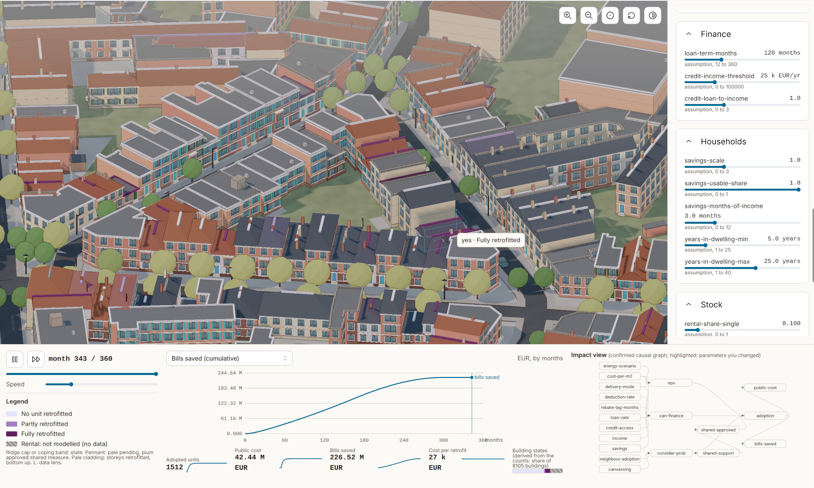
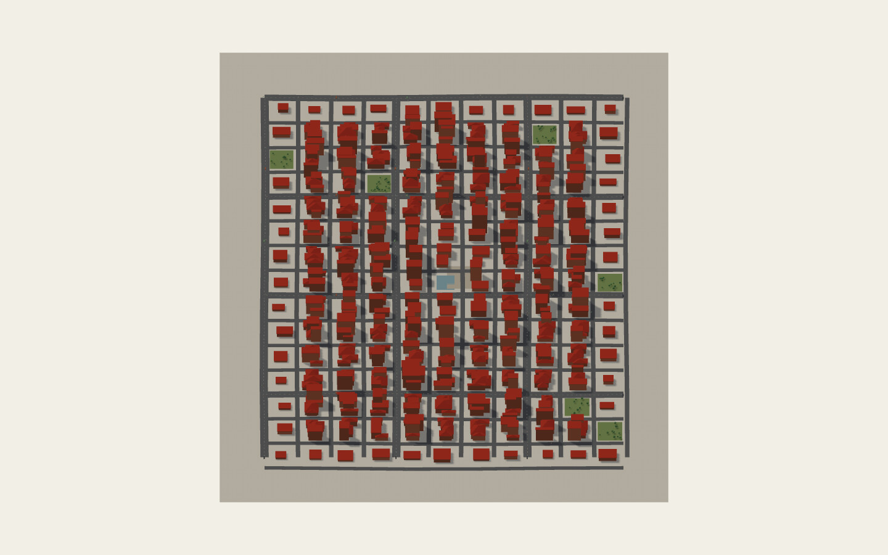
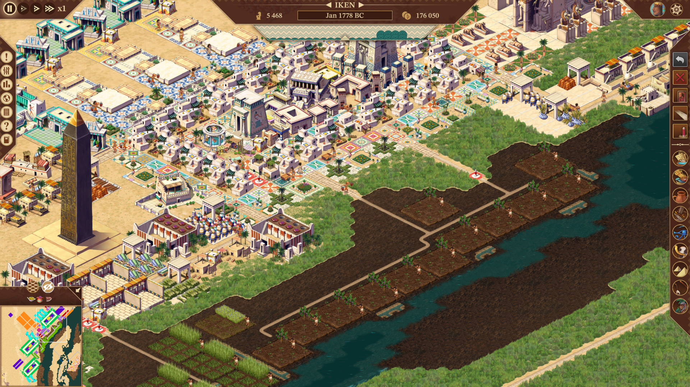
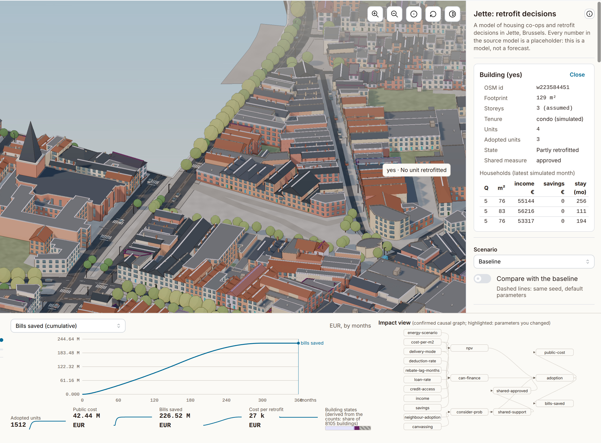
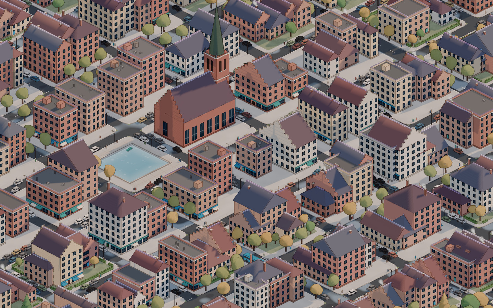
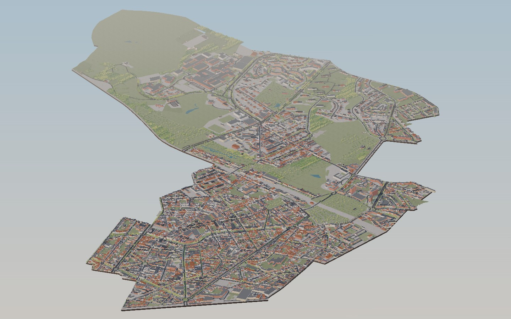

## Paperdolls

Paperdolls is a toolbox for turning NetLogo agent-based models into interactive isometric city-builder simulations. It converts a Netlogo ABM into a single offline HTML file built with three.js and Mantine.

This world available at: worlds/brussels-sonnet/visual/index.html

This simulation is interactive and runs in a browser. When a household in the model decides to insulate its home, that building changes on screen. Cars and people move through the streets. You can press play, change a policy, and watch the neighbourhood respond over the years.

## The Problem (s)

Economists and social scientists often study a city by building a simulation of it. They write rules for thousands of small “agents” — households, landlords, banks — and let them interact over simulated years to see what happens. A common tool for this is NetLogo. 

The trouble is that the results usually look like a spreadsheet or a grid of coloured squares. 

We need a more visual metaphor.

These visual metaphors are readily found in the field of isometric citybuilding videogames, such as Simcities or Pharaoh. Games like these have an engine that hardcodes certain assumptions about how the world works. The core logic of the engine - from how currency works to whether gravity exists - is decided early on in development and rarely changed. 

Unfortunately, building an engine for the Lab at this stage is difficult. We have to be able to experiment with alternate economies and prototyping radical ideas. Game engines and their hardcoded rules mean that we would either have to laboriously create the one engine that can emulate everything possible, a la Dwarf Fortress (hyperlink: https://youtu.be/VAhHkJQ3KgY) or converge on some universal meta-grammar or Turing machine for all economics. 

In the meantime, the slightest "what if we did x differently" means a total rebuild and much frustration, akin to building the Sistine chapel while someone is carting away the foundation. Paperdolls is an attempt to solve this.

## How it works

You can think of Paperdolls as AI-driven factory for building self-contained simulations.  It contains: 

 - Skills, a great many rules that cover things like where to place trees and how to draw data dashboards (roughly 30%)

 - Structured reference data: palettes, building families, schema (Roughly 13%)
 - Code for processing OSM data and NetLogo
 - Code for staging, rendering, camera and viewport controls
 - Code for testing the whole lot at each stage, like do rail lines clip through buildings? does this render smoothly on the browser?

Paperdolls has harness-like components that steer an AI agent into reading your your Netlogo file, converting it into Typescript, testing parity, and then reasoning through how you want the simulation to be visually represented. It has tooling to download Netlogo and real-world reference data from OpenStreetMaps. 

It has visual design guides that force an agent to examine its creation to ensure that it meets a consistent visual standard. It has some components of a lightweight game engine (like a standardized renderer) so we don't have to reinvent the wheel each time.

When an agent (Claude Code, Command Code, OpenChamber, Hermes) uses Paperdolls (using skill.md), it effectively turns into a factory for producing simulation engines. 

Step by step, asking questions and the approval of a human at each stage, it guides an AI model to:

- Understand the model: what the agents are and what each one does.
- Rewrite the model so it runs in the browser, and verify it against the original NetLogo model, run for run.
- Decide what the simulated world should look like: the region, the time of day, the materials, the colours.
- Writes an art bible for itself
- Build the map, either from real street data or from the user's description.

- Assemble the entire visualization: data dashboards, graphs, the works
- Review the look: the assistant takes screenshots and scores them against a reference city, revising until it is good enough. It will also work around failures and unexpected data.

Each new world it outputs is thus a self-contained simulation engine, being about a third of the size of paperdolls itself.

Because we also have lots of explicit logging and reporting baked in, every run also becomes data for improving the next batch of runs.

As a result, paperdolls is flexible: you can use it to simulating housing in Brussels or the collapse of a bank in Westeros. 

To read the manual, see paperdolls.md. 

## What a run looks like

You start the agent on `skill.md` and hand it a NetLogo model. From there it works through eight "gates". At each, it stops at each one for your answer:

1. Model brief. It reads the model and proposes which sliders become controls and which outputs go on the dashboard.
2. World record. You name the world and describe it in a paragraph. 
3. Art bible. You agree on what the place should look like: the region, the time of day, the weather, the materials.
4. Map. It pulls the place from OpenStreetMap, or builds one from your description.
5. Map check and style frame. You see the map and a first street-level picture, and confirm it's the place you meant.
6. Binding. You decide which agents live in which buildings, which variable colours the roofs, and what the scenarios are.
7. Parity. It rewrites the model in TypeScript and verifies it against NetLogo: 200 runs on both sides plus a ten-run determinism check.
8. Sign-off. It builds the whole page, reviews how it looks against the exemplar, checks the frame rate and the interface rules, and hands it over.

## What you get

Each world lives in `worlds/<name>/`:

- `<name>.md`: the world record, with the description, every decision and the attribution.
- `art-bible.md`: what the world should look like.
- `map-data/`: the map extract and the cleaned scene.
- `sim-code/`: the TypeScript model, how it binds to the map, and the parity evidence.
- `page/`: the page's source.
- `visual/index.html`: the finished page. 
- `skill-gaps.md`: everything the agent found unclear or wrong in the skills (we can use these to improve paperdolls).

## Updates

- v 0.11 (Nov 11, 2026): improved rendering pipeline after observing failure modes and outputs of Deepseek 4.1 Flash and Inklin v2 Small Free.

## Models and agents

These are runs for which I've verified the results and collected the interaction metadata:

**Model: Claude 5.5 Sonnet, via Claude Desktop**
Verdict: Excellent. About 1.5 hours of overall processing, does not go over the 5-hour limit window of Anthropic's $20 plan. worlds/conformance and worlds/brussels-sonnet are Sonnet worlds. A specialty of Sonnet is that it automatically gets clickable buildings correct.

**Model: Inkling v2 Free, via OpenCode**
Verdict: Slightly messier than Sonnet 5.5, but very good for a free model. Ran into
_Opencode failed to send message with error: Upstream request failed: [airlock_error] inlined media_
removed some of the generated png files via file manager and used another model (LongCat) to run /compact on the session before resuming with Inkling Free. See worlds/brussels-inkling.

**Model: DeepSeek 4.1 Flash, via Command Code**
Verdict: Gets by with zero issues. Comparable to Sonnet; slightly less quality in the fine details. See worlds/brussels-deepseek. Seems to be slightly better at interface design, imputing variable names, but often fails the graph.

