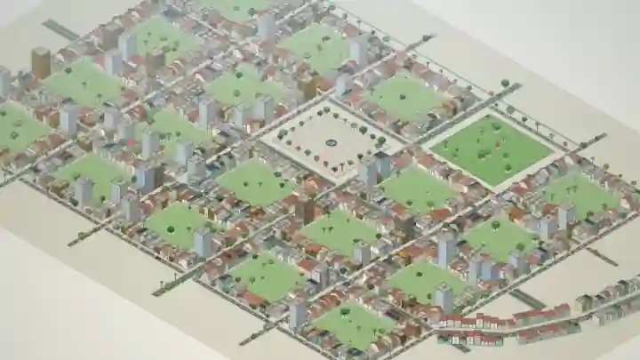
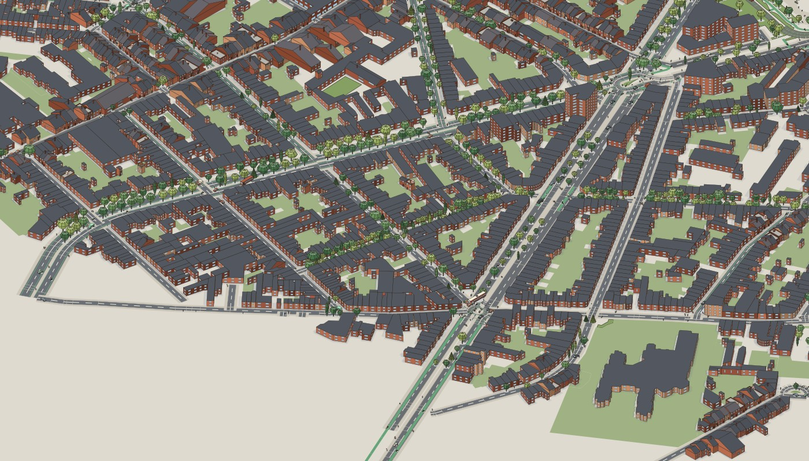
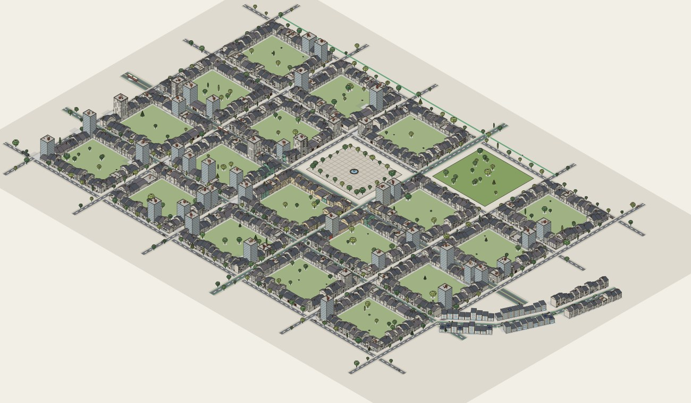
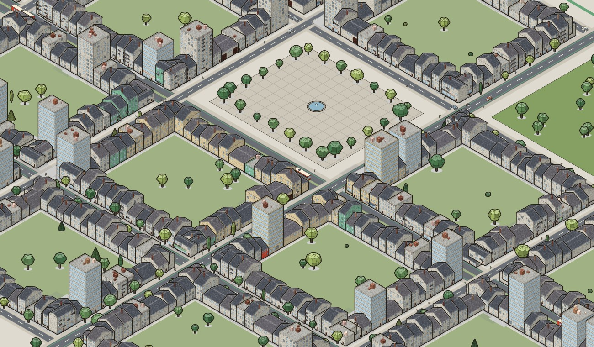

# paperdolls



*A 28-second tour of the viewer on the synthetic placeholder area (South Asian tropical region, Whitewash and clay tile look) with the detail pass and fog on. It was drawn frame by frame at full quality by [viz/record_tour.js](viz/record_tour.js), not screen-recorded, so it is a steady 30 frames a second ([full-quality 1280 by 720 mp4](docs/images/tour.mp4)); the live viewer's speed is a separate matter (see [viz/README.md](viz/README.md)).*

A Claude plugin from the Sci-Fi Economics Lab. It draws agent-based economic simulations and real places as isometric pictures, in a hand-inked style (colorfigures) or a grey technical style (formal), for policy audiences.


*The viewer on the synthetic placeholder area (not a real place), with the South Asian tropical region and the Whitewash and clay tile look. 987 of 1,023 buildings are drawn from assets and 36 as generic extrusions. People and vehicles are decorative, and the building colours are made-up states.*

Its replay page plays a model through time in the same engine: a week scrubber and play button, and a legend made from the model's own declared variables ([docs/replay-mapping.md](docs/replay-mapping.md)).

It makes two kinds of project:

- **Model replay.** Runs the Great Retrofit v2 model (or another model file that follows [the interface](docs/model-interface.md)) and records each building's state, and any variables the model declares ([replay-mapping.md](docs/replay-mapping.md)), week by week. `paperdolls replay` plays the run through time in the viewer, with a week scrubber and a legend made from the declared variables. `paperdolls build` makes the older page of fixed keyframes.
- **Place scene.** Turns an OpenStreetMap extract into a scene and opens it in an offline viewer, with a report of every assumption made.

A replay can be drawn on a place scene (`paperdolls replay ... --scene scene.json`), but the placement is invented: the model has building ids and no coordinates, so each model building is put on a scene building in a fixed order nearest the scene's centre, and the page says so. A scene needs at least as many buildings as the model.

## Examples



*A place scene from a live OpenStreetMap query for part of Jette, Brussels (2,162 buildings, 208 roads, 615 trees), drawn with the detail and ink options. 619 buildings (29%) fit an asset; the rest are plain extrusions. Storeys are mostly assumed, and tree and road details follow the rules in the scene report. © OpenStreetMap contributors (ODbL).*





*A replay of a toy epidemic (the test model in `tests/toy_model.py`, not an economic model) on the synthetic placeholder area, at week 25. The 60 model buildings sit around the central square, coloured by state (tan susceptible, green recovered, red infectious); the other buildings are neutral because the model has no data for them. Placement is invented and people and vehicles are decoration.*

## The rendering engine

The viewer is a SimCity-style isometric rendering engine written in plain JavaScript on a 2D canvas, with no dependencies. It draws buildings, trees, vehicles and people from parametric asset definitions, and it is built to stay interactive on scenes with more than 10,000 entities. On a synthetic scene of 12,276 buildings and 4,093 agents, a settled frame takes 4.6 to 17.5 ms and a panning frame 4.8 to 19.2 ms across 0.7, 1.7 and 4 px per metre (node-canvas on one 8-core desktop CPU, 1200 by 700; `node viz/scale_bench.js` reproduces it). The first frame is slow: 4.9 s when opened fully zoomed out, 0.37 s at 1.7 px per metre, because the far layer and the sprites are built then. A browser will differ.

- **Back-face culling.** Each asset is built once for each of the four isometric headings, with only the faces that point at the camera. Hidden walls are never created, so they are never drawn.
- **Viewport culling.** Anything whose screen bounds miss the canvas is skipped.
- **Sprite cache.** Assets are drawn once into sprites. When the view has held still, sprites are rebuilt at the exact scale and blitted 1:1 on whole pixels, at most 150 rebuilds per frame, so a settled view sharpens over a few frames and never stalls.
- **World-anchored layer caches.** The ground, and at far zoom the buildings, are cached in canvases larger than the screen and anchored to the world. A pan frame is one blit, and a zoom draws the old layer scaled until it settles. Pan frames on a 12,500-building scene went from 46 to 157 ms down to 5 to 14 ms in node-canvas (a later measurement, above, gives 4.8 to 19.2 ms).
- **Smooth zooming.** While the wheel zooms, the drawn canvas is stretched by a CSS transform (the compositor does it, whatever the scene size) and one real frame is drawn when the wheel is quiet; sprites are built under an 8 ms-a-frame time budget with scaled stand-ins; a still view pre-renders the neighbouring zoom levels; and the ground and far-zoom layers are repainted a slice per frame, with the old layer standing in. In a real browser a 6-notch zoom went from a median of 50 ms and a 233 ms frame (with an earlier canvas-copy approach) to a median of 17 ms and a slowest frame of 50 to 67 ms. [viz/README.md](viz/README.md) has the measurements, what failed, and what is left.
- **Zooms finish in focus.** The wheel eases the scale; the stretched picture stays up while the sharp frame is drawn out of sight on a second canvas, then the two cross-fade, with an optional camera-style focus reticle that seeks and locks and an optional lens blur. Four switches in the viewer; [viz/README.md](viz/README.md) has the detail.
- **Far-zoom layer.** Below 1 px per metre, buildings and trees come from a cached layer, people are skipped and vehicles become dots. Ground, road surfaces and shadows are cached per view and theme.
- **Spatial road index.** Fitting a building footprint to an asset stays fast on a city of tens of thousands of buildings.
- **Painter's-algorithm drawing,** back to front.
- **Opt-in finishing, all colorfigures-only and off by default.** `sim.opts.detail` bakes grain, a roof-edge bevel and wall-foot shading into each building sprite, adds roof clutter and darker windows, and softens ground shadows. `ink` draws the heavy outline only on each silhouette. `pixel` (a size above 1, such as 1.5) renders at lower resolution and upscales, with `pixelSmooth` for a soft upscale; `posterize` rounds colours once per sprite and cached layer; `fog` blits a cached haze and vignette. They cost sprite-build time, not per-frame time: settled and panning frames stayed at about 3 ms on the placeholder scene with all of them on. The viewer has a checkbox for each; [viz/README.md](viz/README.md) has the details.
- **Occlusion culling is built and optional.** `sim.opts.occlusion = true` skips items that nearer buildings fully cover, and the picture is identical pixel for pixel. It is off by default because it was slower on every scene measured (13 to 34% more frame time), since a cached sprite blit costs less than the test. The numbers and when it could pay are in [viz/README.md](viz/README.md).

[viz/README.md](viz/README.md) has the asset model, the theme system and the measurements.
## Install

In Claude Code:

```
/plugin marketplace add scifieconomicslab/paperdolls
/plugin install paperdolls@scifi-economics-lab
```

The plugin needs Python 3.10 or newer with numpy, pillow and pyyaml. Run `/paperdolls:doctor` to check. If packages are missing it prints the `pip install` command and asks before running it.

Node.js is optional. Only the JavaScript tests use it.

## Use

Ask Claude to make a replay or a scene, or run a command:

| Command | What it does |
|---|---|
| `/paperdolls:start` | Runs the intake and writes `render.yaml`. |
| `/paperdolls:preview` | Exports a model run, runs the checks, renders keyframes. |
| `/paperdolls:build` | Builds the replay page after you approve the frames. |
| `/paperdolls:place` | Builds a place scene from OpenStreetMap and reads the report with you. |
| `/paperdolls:doctor` | Checks that everything needed is installed. |

The intake is a fixed interview. It asks one question at a time and builds up to a decision table that we can agree to or modify before committing. The questions are listed in [docs/intake-questions.md](docs/intake-questions.md).

## Command line

Everything runs without Claude. The plugin puts `bin/paperdolls` on the PATH. From a checkout, run `bin/paperdolls`, or `pip install -e .` for a `paperdolls` command.

```
paperdolls doctor
paperdolls looks --region nw
paperdolls intake init render.yaml
paperdolls intake next render.yaml
paperdolls intake answer render.yaml ID "value"
paperdolls intake show render.yaml

# model replay
paperdolls export render.yaml --out trajectory.npz
paperdolls check render.yaml
paperdolls frames render.yaml trajectory.npz --out frames/
paperdolls build render.yaml trajectory.npz --out replay.html            # older page: fixed keyframes
paperdolls replay render.yaml trajectory.npz --out live.html              # live page: plays the run through time
paperdolls replay render.yaml trajectory.npz --scene scene.json           # ... on a place scene

# place scene
paperdolls place render.yaml
paperdolls viewer render.yaml
```

The lower-level OpenStreetMap commands are `osm-query`, `osm-fetch` and `ingest`. `assets/demo_render.yaml` holds the Great Retrofit demo configuration (120 households, seed 42).

## What the ingest reads

Buildings (levels, height, type, shop), roads (class, lanes, width, cycle lanes, tunnels), tram lines (matched to the road they run along, or kept as a track), landuse (parks, gardens, squares, water), trees (species, tree rows, scattering into parks and woods), multipolygon relations, and an administrative boundary to clip to. It accepts Overpass JSON, OSM XML and GeoJSON.

The building assets need walls on the isometric axes, and real streets sit at arbitrary angles. The ingest estimates the dominant street direction and rotates the whole frame, choosing the rotation with the highest estimated share of buildings that fit an asset. The report lists every candidate.

Nothing is defaulted quietly. Storeys taken from a building type, an archetype taken from a tag, a width taken from a lane count, trees scattered into a park: each is counted in `scene_report.md` for you to confirm.

## Known issues:

- The 36 palettes (three looks in each of twelve regions) are proposals chosen by eye.
- Facade rules, fleets, tree mixes and drive sides are proposals too.
- Layout, people and vehicles are invented, and so is where a replayed model's buildings stand.
- The OpenStreetMap ingest has had one live run (a bounding box in Jette, Brussels: 2,162 buildings, 28% of them fit an asset). Relation queries and other cities have not been run live.

The full list of open problems, including the Great Retrofit model's, is in [docs/known-issues.md](docs/known-issues.md).

## Layout

- `.claude-plugin/`: `plugin.json` and `marketplace.json`.
- `skills/`: `paperdolls-visuals` (the workflow and its rules) and `palettes`.
- `commands/`: `start`, `preview`, `build`, `place`, `doctor`.
- `agents/fleet-researcher.md`: researches a place's vehicle fleet, with sources and dates.
- `bin/paperdolls`: the launcher.
- `paperdolls/`: the Python pipeline. `paperdolls/ingest/` is the OpenStreetMap ingest; `replay_build.py` builds the replay page.
- `viz/`: the isometric library and viewer, including `replay.js`. See [viz/README.md](viz/README.md).
- `docs/`: the model interface, the replay mapping, the intake questions, known issues, and the design and plan the replay work followed (`docs/superpowers/`).
- `.github/workflows/tests.yml`: runs the Python and JavaScript tests on Python 3.10 and 3.12.
- `vendor/greatretrofit_v2/`: the vendored model and its licence.
- `assets/`: palettes, the intake question bank, the demo configuration and the icon.
- `samples/`: a demo replay and a synthetic OpenStreetMap extract.
- `tests/`: the pytest suite, which also runs the JavaScript tests.

## Develop

```
pip install -r requirements-dev.txt
npm install        # optional: canvas and jsdom for the JavaScript tests
python -m pytest tests -q
```

Without `npm install` the canvas and viewer tests skip. If `bin/paperdolls` gives "Permission denied", run `chmod +x bin/paperdolls`.

## Credits and where the ideas came from

| Source | What we took | Notes |
|---|---|---|
| Colorfigures, by April Zhu (MIT), built on her ISO-GLOW, which builds on Tolga Cohce's iso-figure, per its LICENSE | The visual idea: flat light, mid and dark tones set by face orientation, a heavy ink outline, warm hand-inked colours | The `colorfigures` register. |
| IBM Carbon Design System | The `formal` register: grey tokens and IBM's data-visualisation colours | Colour values and the design idea only. Some tokens were checked against Carbon's documentation. Others (the cool and warm greys, cyan 50, teal 50 and a few more) were written from memory and still need checking. The list is in [viz/README.md](viz/README.md). |
| Standard game-development and graphics techniques | Isometric projection, painter's-algorithm drawing, sprite caching, the monotone-chain convex hull, the minimum-area rectangle, CIELAB conversion, a local map projection, and the small mulberry32 random number generator | Textbook methods, implemented here. |
| The Great Retrofit v2 model | The simulation that the replay draws | MIT-licensed, vendored in `vendor/greatretrofit_v2/`. |
| OpenStreetMap | Map data for place scenes | ODbL. Carry "© OpenStreetMap contributors" with any picture or scene file. |

## Licence

CC BY 4.0 (see [LICENSE](LICENSE)). The vendored Great Retrofit model in `vendor/greatretrofit_v2/` is MIT-licensed, with its own `LICENSE`. OpenStreetMap data is ODbL: carry "© OpenStreetMap contributors" with any picture or scene file.
