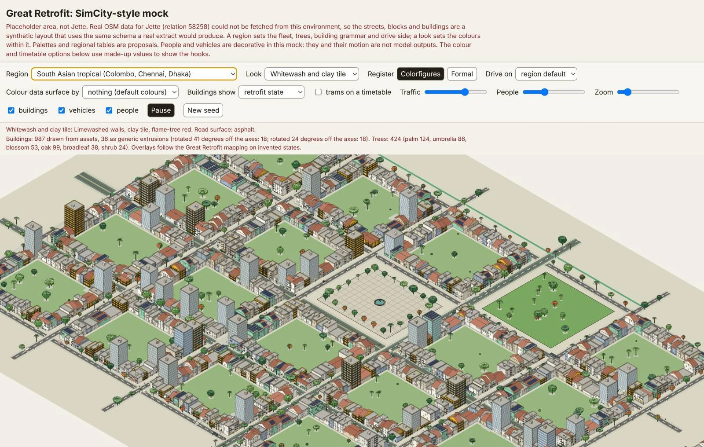

# lab-render

A Claude plugin from the Sci-Fi Economics Lab. It draws agent-based economic simulations and real places as isometric pictures, in a hand-inked style (colorfigures) or a grey technical style (formal), for policy audiences.



*The viewer on the synthetic placeholder area (not a real place), with the South Asian tropical region and the Whitewash and clay tile look. 987 of 1,023 buildings are drawn from assets and 36 as generic extrusions. People and vehicles are decorative, and the building colours are made-up states.*

It makes two kinds of project:

- **Model replay.** Runs the Great Retrofit v2 model (or another model file that follows [the interface](docs/model-interface.md)), records each building's retrofit state and investor ownership week by week, and draws chosen weeks as frames in one offline HTML page.
- **Place scene.** Turns an OpenStreetMap extract into a scene and opens it in an offline viewer, with a report of every assumption made.

The two are not linked. The model has building ids and no coordinates, so a replay cannot yet sit on a real map.

## The rendering engine

The viewer is a SimCity-style isometric rendering engine written in plain JavaScript on a 2D canvas, with no dependencies. It draws buildings, trees, vehicles and people from parametric asset definitions, and it is built to stay interactive on scenes with more than 10,000 entities. A synthetic scene of 12,500 buildings and about 4,800 agents renders at about 25 to 35 ms per frame in a software canvas (node-canvas), so a browser will differ.

- **Back-face culling.** Each asset is built once for each of the four isometric headings, with only the faces that point at the camera. Hidden walls are never created, so they are never drawn.
- **Viewport culling.** Anything whose screen bounds miss the canvas is skipped.
- **Sprite cache.** Assets are drawn once into sprites. When the view has held still, sprites are rebuilt at the exact scale and blitted 1:1 on whole pixels, at most 150 rebuilds per frame, so a settled view sharpens over a few frames and never stalls.
- **World-anchored layer caches.** The ground, and at far zoom the buildings, are cached in canvases larger than the screen and anchored to the world. A pan frame is one blit, and a zoom draws the old layer scaled until it settles. Pan frames on a 12,500-building scene went from 46 to 157 ms down to 5 to 14 ms in node-canvas.
- **Far-zoom layer.** Below 1 px per metre, buildings and trees come from a cached layer, people are skipped and vehicles become dots. Ground, road surfaces and shadows are cached per view and theme.
- **Spatial road index.** Fitting a building footprint to an asset stays fast on a city of tens of thousands of buildings.
- **Painter's-algorithm drawing,** back to front.
- **Occlusion culling is built and optional.** `sim.opts.occlusion = true` skips items that nearer buildings fully cover, and the picture is identical pixel for pixel. It is off by default because it was slower on every scene measured (13 to 34% more frame time), since a cached sprite blit costs less than the test. The numbers and when it could pay are in [viz/README.md](viz/README.md).

[viz/README.md](viz/README.md) has the asset model, the theme system and the measurements.
## Install

In Claude Code:

```
/plugin marketplace add scifieconomicslab/lab-render
/plugin install lab-render@scifi-economics-lab
```

The plugin needs Python 3.10 or newer with numpy, pillow and pyyaml. Run `/lab-render:doctor` to check. If packages are missing it prints the `pip install` command and asks before running it.

Node.js is optional. Only the JavaScript tests use it.

## Use

Ask Claude to make a replay or a scene, or run a command:

| Command | What it does |
|---|---|
| `/lab-render:start` | Runs the intake and writes `render.yaml`. |
| `/lab-render:preview` | Exports a model run, runs the checks, renders keyframes. |
| `/lab-render:build` | Builds the replay page after you approve the frames. |
| `/lab-render:place` | Builds a place scene from OpenStreetMap and reads the report with you. |
| `/lab-render:doctor` | Checks that everything needed is installed. |

The intake is a fixed interview. It asks one question at a time and builds up to a decision table that we can agree to or modify before committing. The questions are listed in [docs/intake-questions.md](docs/intake-questions.md).

## Command line

Everything runs without Claude. The plugin puts `bin/lab-render` on the PATH. From a checkout, run `bin/lab-render`, or `pip install -e .` for a `lab-render` command.

```
lab-render doctor
lab-render looks --region nw
lab-render intake init render.yaml
lab-render intake next render.yaml
lab-render intake answer render.yaml ID "value"
lab-render intake show render.yaml

# model replay
lab-render export render.yaml --out trajectory.npz
lab-render check render.yaml
lab-render frames render.yaml trajectory.npz --out frames/
lab-render build render.yaml trajectory.npz --out replay.html

# place scene
lab-render place render.yaml
lab-render viewer render.yaml
```

The lower-level OpenStreetMap commands are `osm-query`, `osm-fetch` and `ingest`. `assets/demo_render.yaml` holds the Great Retrofit demo configuration (120 households, seed 42).

## What the ingest reads

Buildings (levels, height, type, shop), roads (class, lanes, width, cycle lanes, tunnels), tram lines (matched to the road they run along, or kept as a track), landuse (parks, gardens, squares, water), trees (species, tree rows, scattering into parks and woods), multipolygon relations, and an administrative boundary to clip to. It accepts Overpass JSON, OSM XML and GeoJSON.

The building assets need walls on the isometric axes, and real streets sit at arbitrary angles. The ingest estimates the dominant street direction and rotates the whole frame, choosing the rotation with the highest estimated share of buildings that fit an asset. The report lists every candidate.

Nothing is defaulted quietly. Storeys taken from a building type, an archetype taken from a tag, a width taken from a lane count, trees scattered into a park: each is counted in `scene_report.md` for you to confirm.

## Known issues:

- The 36 palettes (three looks in each of twelve regions) are proposals chosen by eye.
- Facade rules, fleets, tree mixes and drive sides are proposals too.
- Layout, people and vehicles are invented.
- The OpenStreetMap ingest has run only on a synthetic extract. The Overpass query and fetch client have not been run against the live service.

The full list of open problems, including the Great Retrofit model's, is in [docs/known-issues.md](docs/known-issues.md).

## Layout

- `.claude-plugin/`: `plugin.json` and `marketplace.json`.
- `skills/`: `lab-render-visuals` (the workflow and its rules) and `palettes`.
- `commands/`: `start`, `preview`, `build`, `place`, `doctor`.
- `agents/fleet-researcher.md`: researches a place's vehicle fleet, with sources and dates.
- `bin/lab-render`: the launcher.
- `lab_render/`: the Python pipeline. `lab_render/ingest/` is the OpenStreetMap ingest.
- `viz/`: the isometric library and viewer. See [viz/README.md](viz/README.md).
- `vendor/greatretrofit_v2/`: the vendored model and its licence.
- `assets/`: palettes, the intake question bank, the demo configuration and the icon.
- `samples/`: a demo replay and a synthetic OpenStreetMap extract.
- `tests/`: the pytest suite, which also runs the JavaScript tests.

## Develop

```
pip install -r requirements-dev.txt
npm install        # optional: canvas and jsdom for the JavaScript tests
python -m pytest tests -q
```

Without `npm install` the canvas and viewer tests skip. If `bin/lab-render` gives "Permission denied", run `chmod +x bin/lab-render`.

## Credits and where the ideas came from

| Source | What we took | Notes |
|---|---|---|
| Colorfigures, by April Zhu (MIT), built on her ISO-GLOW, which builds on Tolga Cohce's iso-figure, per its LICENSE | The visual idea: flat light, mid and dark tones set by face orientation, a heavy ink outline, warm hand-inked colours | The `colorfigures` register. |
| IBM Carbon Design System | The `formal` register: grey tokens and IBM's data-visualisation colours | Colour values and the design idea only. Some tokens were checked against Carbon's documentation. Others (the cool and warm greys, cyan 50, teal 50 and a few more) were written from memory and still need checking. The list is in [viz/README.md](viz/README.md). |
| Standard game-development and graphics techniques | Isometric projection, painter's-algorithm drawing, sprite caching, the monotone-chain convex hull, the minimum-area rectangle, CIELAB conversion, a local map projection, and the small mulberry32 random number generator | Textbook methods, implemented here. |
| The Great Retrofit v2 model | The simulation that the replay draws | MIT-licensed, vendored in `vendor/greatretrofit_v2/`. |
| OpenStreetMap | Map data for place scenes | ODbL. Carry "© OpenStreetMap contributors" with any picture or scene file. |

## Licence

CC BY 4.0 (see [LICENSE](LICENSE)). The vendored Great Retrofit model in `vendor/greatretrofit_v2/` is MIT-licensed, with its own `LICENSE`. OpenStreetMap data is ODbL: carry "© OpenStreetMap contributors" with any picture or scene file.
