# Paperdolls: the manual

Paperdolls takes a NetLogo agent-based model and turns it into a small city you can explore in a browser. You look down on it at an angle, the way you would in a city-building game. The buildings, streets and parks come from a real map (or from a description of an invented place), and the model's agents live in them. Press play and the model runs in the streets instead of in a plot window.

What comes out is one HTML file. It opens offline, needs nothing installed, and can be emailed, put on a website or shown in a meeting.

This manual explains how all of that works.

## Contents

1. The idea in one picture
2. A primer on the web pieces
3. What is in the repository
4. A run, gate by gate
5. The three contracts
6. From NetLogo to TypeScript
7. From OpenStreetMap to a scene
8. Deciding the look
9. The page and the stage
10. The world's own scene code
11. The interface
12. Checking the work
13. Getting better between runs
14. Running it yourself
15. What it will not do
16. Glossary

---

## 1. The idea in one picture

A game engine hardcodes how its world works, and we need to try out economies that no single engine would anticipate. So instead of an engine, Paperdolls is a factory for making small engines. It is a written method that an AI coding agent follows, step by step, with a person approving each stage. Every run produces a new, self-contained simulation.

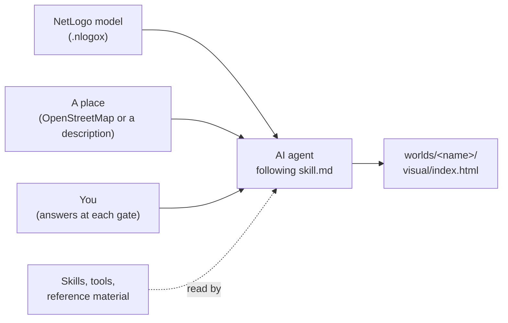

The agent can be any coding agent that reads files and runs commands. So far Paperdolls has been run by Claude (Sonnet 5.5) in Claude Code, DeepSeek 4.1 Flash in Command Code, and Inkling 2 Small in OpenChamber.

## 2. A primer on the web pieces

You can skip this section if you build web front ends for a living.

A finished world is a web page, and a web page is three things: HTML (the structure), CSS (the styling) and JavaScript (the code). Paperdolls bundles all three into one file, along with the map data and the model.

The code is written in TypeScript and turned into JavaScript at build time. TypeScript is JavaScript with type annotations: `let height: number = 3.1` instead of `let height = 3.1`. The types are checked before the code runs and then stripped away. If you know Python with type hints, the experience is close.

These are the other names you will meet:

| name | what it is | rough equivalent |
|---|---|---|
| Node | runs JavaScript and TypeScript outside a browser; our tools and tests use it | the `python` interpreter |
| npm, `package.json` | installs libraries and records their exact versions | `pip` and `requirements.txt` |
| Vite | the build tool: reads the TypeScript, bundles it and writes `index.html` | a compiler and linker |
| three.js | the 3D library that draws the city with the graphics card (WebGL) | OpenGL with a scene graph on top |
| React and Mantine | the library for the panels, sliders and charts around the city | a GUI toolkit such as Qt |
| Web Worker | a second thread inside the page; the model runs there so the drawing never stalls | a background thread |
| JSON | the text format for data files such as `scene.json` | a Python dict written to disk |

A page has one main thread that both draws and responds to the mouse. If the model ran there, every simulated month would freeze the picture. So every world runs its model in a worker and sends results back to the main thread, which only draws them.

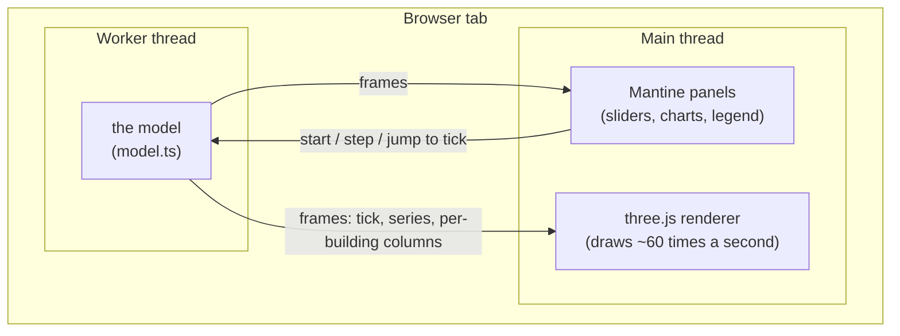

## 3. What is in the repository

```text
skill.md            the entry point the agent loads first: the rules and the routing table
paperdolls.md       this manual
skills/             eight skills, written as markdown
reference/          building types, palettes, the interface rules, the exemplar city, templates
schemas/            the formal shapes of scene.json and model-binding.json
tools/              code: map ingest, the NetLogo runtime and parity harness, the stage, measuring tools, checkers
netlogomodels/      models to run
worlds/             one folder per finished world
```

The repository holds three kinds of material, and each does a different job.

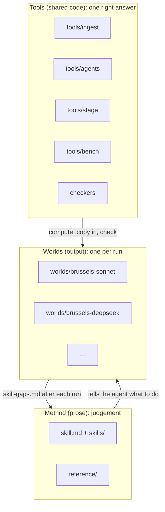

The rule we use to decide where something goes: if two good runs should produce the same thing, it belongs in a tool. If two good runs should produce different but equally good things, it belongs in prose.

By size, the hand-written part of the repository is roughly 31% prose, 42% code, 14% tests and 14% reference data. That count leaves out the test fixtures recorded from NetLogo and OpenStreetMap, the exemplar screenshots, and the worlds.

The eight skills each own one part of the job:

| skill | owns |
|---|---|
| `paperdolls-pipeline` | the gates, the questions, the decisions log, the final report |
| `paperdolls-netlogo-to-ts` | reading the model, converting it, proving parity |
| `paperdolls-map-world` | getting the place: OpenStreetMap or construction; the scene contract; checking the map |
| `paperdolls-art-direction` | the art bible |
| `paperdolls-scene-craft` | drawing the world: the house style in numbers and the recipes |
| `paperdolls-beauty-review` | judging the pictures against the exemplar |
| `paperdolls-interface-ui` | the panels around the city |
| `paperdolls-technology` | versions, the offline build, the worker, performance budgets |

`skill.md` routes the agent to one skill at a time, so it only reads what the current gate needs.

## 4. A run, gate by gate

You start the agent on `skill.md` and hand it a NetLogo model. It runs a preflight check, then works through eight gates. At each one it shows you something and waits for your answer. A "yes" applies to the thing it showed; if it edits that thing afterwards, it has to ask again.

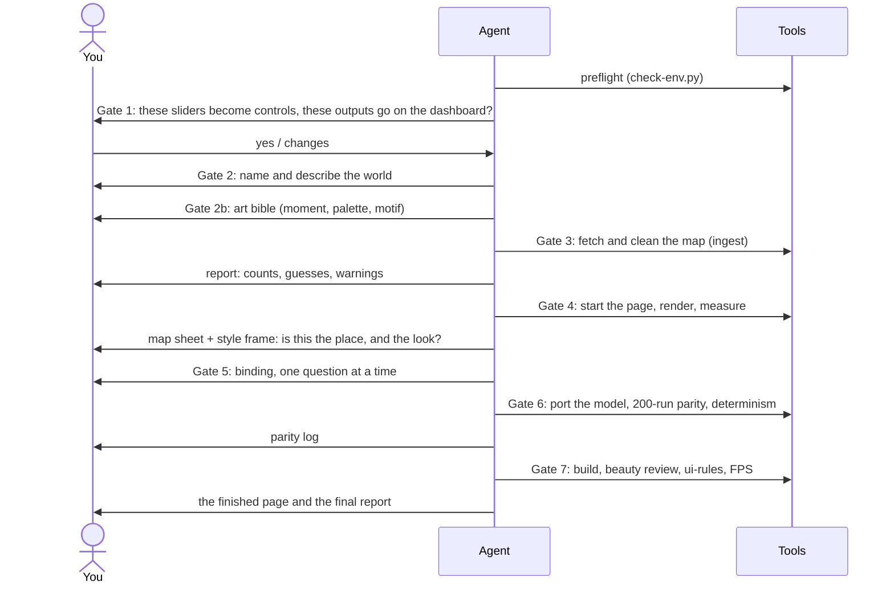

What each gate produces:

| gate | you are asked | the agent writes | checked by |
|---|---|---|---|
| Preflight | nothing, unless something is missing | nothing | `tools/check-env.py` |
| 1. Model brief | which sliders become live controls, which outputs go on the dashboard | the agent and parameter tables in the world record | you |
| 2. World record | the world's name and one paragraph describing it | `worlds/<name>/<name>.md`, with your paragraph kept word for word | you |
| 2b. Art bible | the region, the moment, the palette, the one detail that makes it itself | `art-bible.md` | you |
| 3. Map source | OpenStreetMap (a relation, a box or a file) or a description | `map-data/scene.json` and a report | the ingest report, read out to you |
| 4. Map and style frame | is this the place you meant, and does it look the way the bible says? | the page project and a first picture | one beauty round |
| 5. Binding | which agents live in which buildings, the roof colour, structural readings, the causal graph, scenarios | `sim-code/model-binding.json` | `check-schemas.py`, `check-world.py` |
| 6. Parity | before long runs: whether to start them | `sim-code/model.ts`, `sim-code/parity.md` | the parity harness |
| 7. Sign-off | does it work for you? | `visual/index.html` and `final-report.md` | ui-rules, beauty review, FPS, single-file check |

Every decision goes into the world record's decisions log as one dated line. The log is append-only. Anything the agent had to guess is labelled as a guess, both in the record and on the page.

At the end, a world folder looks like this:

```text
worlds/<name>/
  <name>.md            the world record: description, decisions log, attribution
  art-bible.md         what the world should look like, and why
  map-data/            the map extract, scene.json, the ingest report, the map check images
  sim-code/            model.ts, model-binding.json, parity.md, parity results
  page/                the page's source code
  visual/index.html    the finished page: the thing you share
  visual/review/       the beauty-review rounds
  snapshots/v1/        a frozen, hashed copy of the inputs at sign-off
  skill-gaps.md        everything the agent found unclear or wrong in the skills
  final-report.md      the gate results, the scores, what is guessed, what is left
```

## 5. The three contracts

Three inputs meet in the page: the model, the map and the art bible. They meet only through written files with fixed shapes. The page never reads the NetLogo file or OpenStreetMap directly.

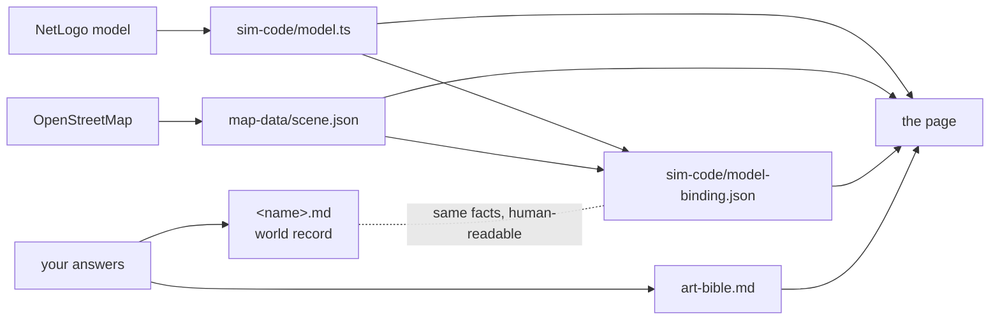

### The scene: `map-data/scene.json`

The scene is the place, in metres, with the origin near its centre. Its shape is fixed by `schemas/scene.json`, but its vocabulary is open: a new kind of building is a new value, not a schema change. A trimmed example:

```json
{
  "area": {
    "name": "Jette", "source": "osm", "osm_relation": 58258,
    "rotation_deg": 0, "extent_m": [4210, 3480],
    "family": "real", "palette": "nw",
    "boundary": [[-1840.2, 610.5], [-1795.0, 640.1], "…"]
  },
  "structures": [
    { "id": "w123", "kind": "building", "footprint": [[12.1, 4.0], [19.8, 4.0], [19.8, 15.2], [12.1, 15.2]],
      "levels": 3, "levels_assumed": true, "archetype": "terrace",
      "economic_class": "residential", "residential": "probable", "height": 9.3 }
  ],
  "roads":   [{ "id": "w88", "class": "local", "pts": [[0, 0], [140, 2]], "tram": false, "cycle": false }],
  "rails":   [{ "id": "w91", "kind": "rail", "pts": [[-900, 30], [900, 55]] }],
  "landuse": [{ "id": "w77", "kind": "park", "cover": "wood", "footprint": ["…"] }],
  "trees":   [[103.5, 40.2], [110.0, 44.8, "conifer", 1.2]]
}
```

A few fields need explaining:

- `boundary` is the edge of the place (for Jette, the commune). The plinth, the ground and the camera's overview shot all use it.
- `levels_assumed: true` means OpenStreetMap had no storey count, so the ingest used a default. In Jette, 99% of storeys are assumed.
- `residential` is `residential` when the data says it is a home, `probable` when its type and size suggest a home, and `other` otherwise. A model's households live in the first two.
- `kind` on land use is coarse (park, garden, water, square, rail, bare). `cover` is finer (wood, pitch, cemetery and so on) and tells the page which surface to draw.

### The binding: `sim-code/model-binding.json`

The binding says how the model sits in the place. A trimmed version of the DeepSeek Jette world's binding:

```json
{
  "family": "real", "region": "nw", "look": "house",
  "dashboard": { "outputs": ["monitor:adopted_units", "monitor:public_cost"] },
  "bindings": [{
    "entity": "buildings", "layer": "structures",
    "top_color": {
      "field": "retrofit_state", "domain": [0, 2], "label": "Retrofit state",
      "ramp": { "name": "plum", "kind": "sequential",
                "stops": [[0.63, 0.035, 300], [0.50, 0.065, 320], [0.38, 0.10, 340]] }
    }
  }],
  "architecture": [
    { "entity": "buildings", "field": "approved", "treatment": "mark", "preset": "flag", "label": "Shared measure passed" }
  ],
  "scenarios": [{ "id": "baseline", "label": "Baseline", "interventions": [] }]
}
```

`top_color` is the one model variable the roofs show. `architecture` lists the "structural readings": model variables drawn into the buildings themselves, such as a flag on a roof or cladding that climbs a facade as a building is retrofitted. The ramp's `stops` are colours in OKLCH (lightness, chroma, hue), which section 8 explains.

### The world record: `<name>.md`

The world record is the human-readable twin of the other two, plus the decisions log and the attribution. It is a markdown file built from `reference/templates/world.md`. `tools/check-world.py` checks that it has every section in order, that every gate has a dated log line, and that it agrees with the binding.

## 6. From NetLogo to TypeScript

### The runtime

A converted model is written against a small library in `tools/agents/` that provides NetLogo's verbs in TypeScript: `ask`, `createTurtles`, `oneOf`, `random`, `tick` and so on. The converted model keeps NetLogo's procedure names and order, with the NetLogo source in a comment above each function. That keeps the two easy to compare line by line.

Here is one procedure from Wolf Sheep Predation, the worked example in `tools/agents/examples/wolf-sheep.ts`:

```text
NetLogo:     to move
               rt random 50
               lt random 50
               fd 1
             end
```

```ts
// to move: rt random 50  lt random 50  fd 1
function move(m: Ctx, t: AnyAgent) { t.rt(m.random(50)); t.lt(m.random(50)); t.fd(1); }
```

`m` is the model's context: the world, the random number generator, the parameters. `t` is the turtle. `m: Ctx` and `t: AnyAgent` are type annotations; they say what kind of thing each argument is, and they disappear in the built page.

The whole model is one call to `defineModel({...})`, which declares the parameters (the sliders), the breeds, `setup`, `go`, the plots and monitors, and any interventions a user can trigger mid-run.

### How the page talks to a model

Every converted model has the same small interface, whatever it simulates:

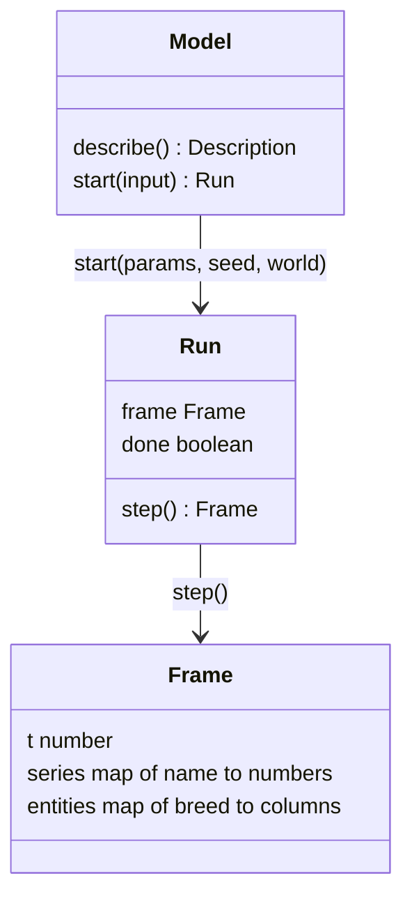

- `describe()` lists the parameters, their ranges, the outputs and the time unit. The page builds its sliders and charts from this, so it never hardcodes a model's controls.
- `start()` begins a run from tick 0 with given parameters and a seed.
- `step()` advances one tick and returns a frame. A frame carries the tick, the plotted series, and each breed's variables as columns: one array per variable, one entry per agent. Columns are typed arrays (packed numbers, like a NumPy array), which a worker can hand to the main thread cheaply.

### Parity: proving the port matches NetLogo

A port that is almost right is worse than none, because it looks authoritative. So Gate 6 proves the TypeScript version behaves like the original, in three layers:

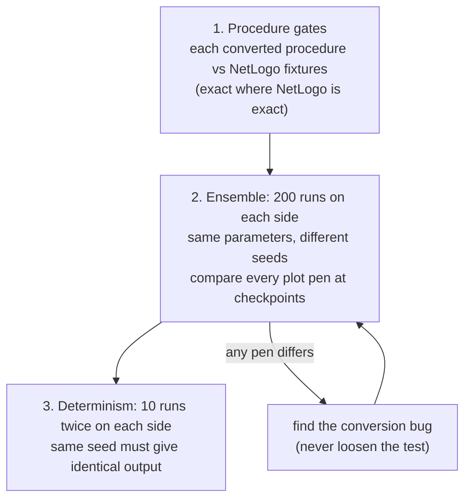

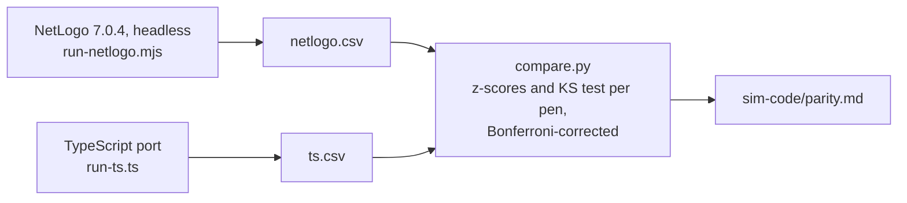

For a model whose randomness flows through its own seed slider (as in the Brussels retrofit model, which carries its own random number generator), both sides vary that slider per run. All results are written into the world's `sim-code/parity/results/`, never into `tools/`.

There is one limit. Parity is run on the configuration NetLogo can run: the model's own synthetic world, with its generated table of buildings. The page's real-map run uses the same code fed with map-derived inputs (real footprints, assumed storeys), and NetLogo has no equivalent of it. The page, `parity.md` and the final report all say this. The arithmetic is verified; the Jette numbers are illustrative.

Some models keep their places as a table of records with no coordinates (the retrofit model keeps buildings this way). That still counts as spatial. At Gate 5 each record becomes one real building from the scene, taking its floor area and storeys from the map.

## 7. From OpenStreetMap to a scene

`tools/ingest` (Python) turns OpenStreetMap data into `scene.json`. It does computation only, and every guess it makes is counted in a report.

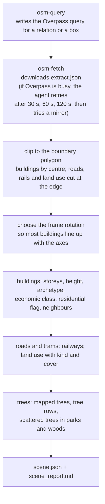

The building classification follows a fixed order, set out in `reference/building-archetypes.md`:

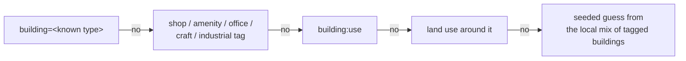

In Jette, 93% of buildings reach the last step. OpenStreetMap there mostly says `building=yes` and nothing else. The report says so, the agent reads the number out at Gate 3, and the page labels the classes as guesses.

The other path is `tools/construct`, which generates a scene for an invented place from a written spec. It writes the same `scene.json`, so everything downstream works the same way.

## 8. Deciding the look

### The art bible

At Gate 2b the agent and you agree on what the world should look like, in words, before any map is fetched. The art bible (`art-bible.md`) records:

- the moment: time of day, season, weather ("3 pm in late May, sunny");
- the palette, as numbers;
- the light: the sun's direction, warmth and strength;
- density and skyline;
- one signature motif, a detail that makes the place itself (crow-stepped gables, limestone bands in brick);
- what life is on the streets;
- how data is shown;
- "not this": what the world must not look like.

At Gate 4 the first render is checked against it.

### Colour in OKLCH

Palettes are written in OKLCH: lightness (0 to 1), chroma (how colourful) and hue (0 to 360 degrees). Unlike RGB, equal steps in OKLCH look equal to the eye, so lightness rules can be written as numbers and checked.

The palette is built from lightness bands first and hue second. The order is what makes a city read clearly when you squint at it:

```text
lightness (OKLCH L)
1.00 ┤
     │  ground, pavements   0.90–0.96   ← lightest surface
0.90 ┤
     │
0.80 ┤  walls               0.60–0.82
     │
0.60 ┤                                  ← roofs at least 0.15 below the wall average
     │  roofs              0.30–0.48
0.40 ┤
     │
0.20 ┤  ink outlines                    ← darkest
0.00 ┤
```

There is also a chroma budget. World surfaces stay muted (chroma at most 0.08), one accent family may go up to 0.16, and the data ramp is kept distinct from both.

### Why the Brussels worlds came out purple

The roofs show one model variable on a colour ramp. Red-to-green is banned, because colour-blind viewers cannot read it. The ramp has to stay at least 60 degrees of hue away from the walls, the accent and the sky, and out of the greens so data never looks like grass. In a brick town the walls sit around hue 25–50 and the accent opposite them around 205–235 (blue), so the only gap left is purple to magenta:

```text
hue  0        60       120      180      240      300      360
     |--------|--------|--------|--------|--------|--------|
     [walls: brick]
                  [vegetation]
                                    [accent: blue][sky]
                                                    [ free: data ramp ]
```

That is the rule working, not a default. To get a different ramp, free its hues first: move the accent to ochre or teal, and blue becomes available for data. The agent offers this at Gate 2b.

### The house style in numbers

Some things are the same in every world. They are written as numbers in `skills/paperdolls-scene-craft/SKILL.md`:

| lever | value |
|---|---|
| camera | orthographic, 30° elevation, 45° azimuth |
| exposure | 1.3, AgX tone mapping |
| sunlight | 2.4–2.8 strength, 3,500–5,000 K |
| sky fill | 1.5–1.8 strength, 7,000–9,500 K |
| shading | three-step toon shading |
| ink | 1.5 px at street zoom, 1 px at neighbourhood, none at overview |
| ambient occlusion | blend 0.65, at half resolution |
| data share | data colour covers at most 15% of building pixels in the normal view |

## 9. The page and the stage

### What the page is made of

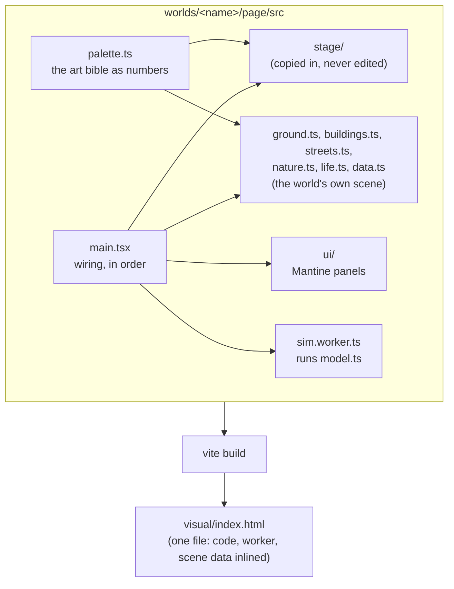

Most of the page is the world's own code, written fresh each run from the recipes. The exception is the stage.

### The stage

`tools/stage/` holds the parts every world needs and no world should rewrite. They have one right answer, yet the first three runs each rebuilt them differently, and two of the three skipped the worker. It is about 700 lines of TypeScript, written against three.js r180, in four files:

| file | contains |
|---|---|
| `pipeline.ts` | the renderer, lights, sky gradient and post-processing; shadows refitted to the view; the boundary plinth |
| `camera.ts` | the camera rig, the three shots, the controls |
| `snapshot.ts` | the URL parameters the capture tools use, and the "ready" signal |
| `sim.ts` | the model worker: `serveModel` inside the worker, `SimClient` on the page |

The stage decides nothing visual. Every colour, light strength and haze amount comes in from the art bible through two settings objects, `StageLook` and `PlinthLook`:

```ts
const stage = createStage(canvas, {
  exposure: 1.3,
  key:  { color: '#ffe2c0', intensity: 2.6, azimuthDeg: 220, elevationDeg: 38 },   // the sun
  fill: { sky: '#cfe0ff', ground: '#c9c2b4', intensity: 1.6 },                     // sky light
  sky:  { top: '#a9c4de', horizon: '#e6e2d8' },
  ink:  '#2b2630',
});
```

An earlier version of Paperdolls shipped a kit of buildings and materials, and every world was capped at the kit's quality. The stage avoids that by owning no geometry and no materials.

### How a frame is drawn

Each frame goes through a fixed sequence of passes. A pass draws the scene, or an image of it, into an off-screen buffer that the next pass reads.

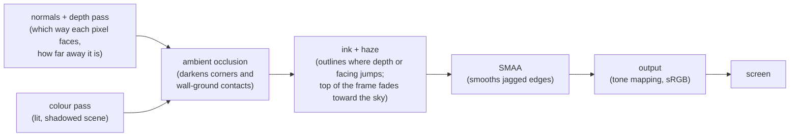

The haze needs a word of explanation. With an orthographic camera there is no perspective, so ordinary fog barely changes from front to back. The stage fades the upper part of the frame toward the horizon colour instead, which the eye reads as distance. The amount depends on zoom: 0.10 at street level, 0.28 at neighbourhood, 0.40 at overview.

### The camera

```text
                  camera (1,500 m away, looking down)
                     \
                      \  30° above the ground
                       \
                        \
   ____________________\_____________________ ground
                        target

   seen from above: the camera sits at 45° between two street axes,
   and Q / E rotate it in 90° steps.

            N
            |
     W -----+----- E        camera azimuth 45°
            |   ↖
            S     camera
```

The camera is orthographic: parallel lines stay parallel and nothing shrinks with distance, as in a classic city builder. One number, the view width in metres, drives everything that changes with zoom: ink width, haze, the ambient occlusion radius, the shadow area and which details are drawn.

| shot | view width | what it must show |
|---|---|---|
| overview | the whole boundary, fitted to the screen | districts, skyline, landmark, parks and water, the world's edge |
| neighbourhood (the opening shot) | about 220 m | window rhythm, pavements, tree canopies, moving traffic |
| street | about 62 m | framed windows, doors and shopfronts, people, lamps, benches, the signature motif |

The overview fits the boundary as it appears on screen at the current angle, so the city fills the frame whichever way it is rotated. Before the stage, each run wrote its own fit; in one of them Jette filled 16% of the frame.

Controls: drag to pan, scroll or pinch to zoom around the pointer, A/D and the arrow keys to pan, W/S to zoom, Q and E to rotate, F to fit. Camera moves ease over 250–450 ms, and happen instantly when the viewer has asked their system for reduced motion.

### The snapshot contract

The review tools need to load a page and get the same picture every time. So every page understands these URL parameters:

| parameter | effect |
|---|---|
| `snapshot=1` | hide the panels, fix all decorative randomness, no easing |
| `shot=overview`, `neighbourhood` or `street` | which shot |
| `lens=1` | turn on the data lens |
| `angle=90` | rotate the camera by that many degrees |
| `view=top` | look straight down (for the map check) |
| `t=120` | show the model at tick 120 |
| `clock=1.5` | set the decorative clock (traffic, people) to 1.5 seconds |

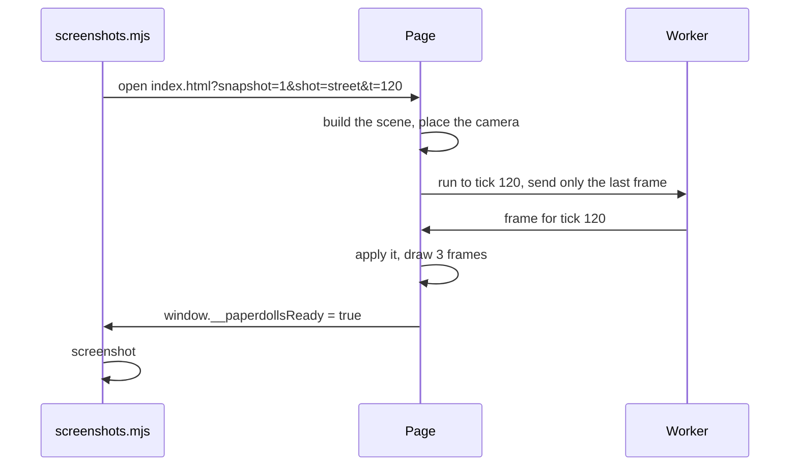

When the URL gives no `t`, the page picks the tick where the roof variable is most varied. For a number that is the widest spread between quartiles; for a state such as none/partial/done, the most even mix of states. A frame where every roof is the same colour shows nothing.

### Getting the stage into a world

The stage is copied into each world rather than shared, so that a world's snapshot contains exactly the stage it was built with.

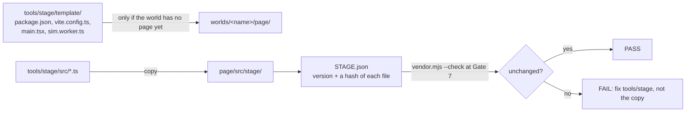

```bash
node tools/stage/vendor.mjs worlds/<name>           # create the page project and copy the stage in
node tools/stage/vendor.mjs worlds/<name> --check   # confirm the copy is unedited
```

To change the stage, edit `tools/stage/`, bump its `VERSION` file and copy it into the worlds that want the change.

## 10. The world's own scene code

Everything you judge with your eyes is written per world from the recipes in `skills/paperdolls-scene-craft/recipes/`. Two worlds share techniques, not code, so neither is capped at the quality of a shared kit.

### Build order

The agent builds in a fixed order and checks the picture after each step. Problems with light and value are cheap to fix early and expensive once facades exist.

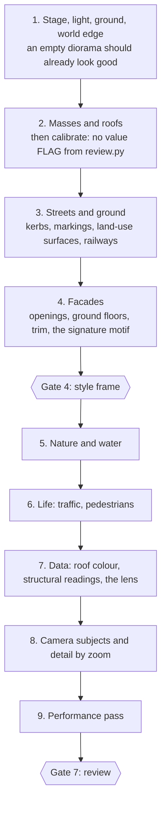

### The recipes

| recipe | covers |
|---|---|
| `render-pipeline.md` | what the stage's passes do and how to tune them |
| `light-and-time.md` | sun and sky, colour temperature, dusk lights |
| `palette-method.md` | building the palette and data ramps in OKLCH |
| `composition.md` | giving a map a centre, a landmark, a height gradient and an edge |
| `buildings.md` | masses, roofs, facades, ground floors, roof furniture, landmarks |
| `streets-and-ground.md` | roads, pavements, markings, plots, land-use surfaces, railways |
| `nature-and-water.md` | trees, hedges, grass, water, shorelines |
| `life.md` | traffic, pedestrians, smoke, birds, model agents |
| `data-in-the-world.md` | the roof colour, structural readings, the lens, missing data, hover |
| `camera.md` | the stage's camera, and choosing what the shots frame |
| `performance.md` | draw-call and triangle budgets, instancing, level of detail |

### An example: long terraces

Real maps throw up problems a grid never has. A row of terraced houses is often mapped as one footprint 40 to 120 metres long. Drawn as one building with one roof, it looks like a barracks. The buildings recipe splits it first:

```text
one OSM footprint, 62 m long
┌──────────────────────────────────────────────────────────────┐
│                                                              │
└──────────────────────────────────────────────────────────────┘
                         street side ↓

split into plots of 5–7.5 m along the street
┌──────┬──────┬───────┬──────┬──────┬───────┬──────┬──────┬───┐
│      │      │       │      │      │       │      │      │   │
└──────┴──────┴───────┴──────┴──────┴───────┴──────┴──────┴───┘
 each plot gets its own wall colour, door and ground floor;
 eave height steps every 1–3 plots; 30–50% get a dormer;
 chimneys sit on the party walls
```

All the plots still belong to the one original building, so they show the same data value and highlight together on hover.

The same recipe cleans ragged footprints first (OpenStreetMap walls often arrive as dozens of 1-metre segments), and sets rules for picking and drawing a landmark: a church with nave, tower and spire, a town hall with a clock tower, a station hall on the railway.

### Data in the world

The roof variable is not painted over whole roofs, which would turn the city into a heat map. The normal view shows it as accents. The data lens, toggled with `L`, shows it fully.

```text
normal view                            data lens (L)
  ▲  ridge cap in the ramp colour        ▲  the data at full strength
 ╱ ╲ roof keeps its material,           ╱█╲
╱   ╲ tinted at most 10%               ╱███╲
│ ▯ │                                  │ ▯ │
│ ▯ │                                  │ ▯ │
```

Missing data is a named state, drawn as a neutral colour with a 45° hatch. It never borrows the low end of the ramp, because "no data" and "zero" mean different things.

Structural readings draw a variable into the building itself: a pennant on the roof, scaffolding that rises as work proceeds, cladding that climbs storey by storey. A mark such as a pennant goes on the exception. If more than 30% of buildings would carry one, the page marks the minority instead or leaves it to the lens.

## 11. The interface

The panels are built with Mantine, a React component library. The layout is fixed so every world reads the same way:

```text
┌─────────────────────────────────────────────────────┬───────────────┐
│                                                     │ controls      │
│                                                     │  sliders      │
│              the city (canvas)                      │  switches     │
│                                                     │  scenarios    │
│                                                     │  seed, reset  │
│                                                     │               │
│                                                     │ attribution   │
├─────────────────────────────────────────────────────┴───────────────┤
│ timeline: play · speed · seek   │ legend │ main chart │ outputs │ impact │
└─────────────────────────────────────────────────────────────────────┘
                                   analyst drawer (slides in): parity, sources,
                                   assumptions, model version, raw data export
```

- The sidebar holds only what you can change.
- The bottom dock holds what the model reports. The main chart is the largest data object on the page.
- The impact view draws the causal graph you confirmed at Gate 5, and nothing else.
- The analyst drawer is for people who want to check the work: the parity log, where every number came from, what was guessed.

A parameter change starts a new run from tick 0 with the same seed. When a model declares no interventions, the scenarios are named sets of parameters, and the page presents them as comparisons, not as actions taken mid-run.

## 12. Checking the work

### The beauty review

Every model draws a city differently, and models grade their own pictures too kindly. In the first Brussels test both cheaper models scored themselves 4 out of 5 on every criterion, while their pictures were visibly below the exemplar. The review is built around that.

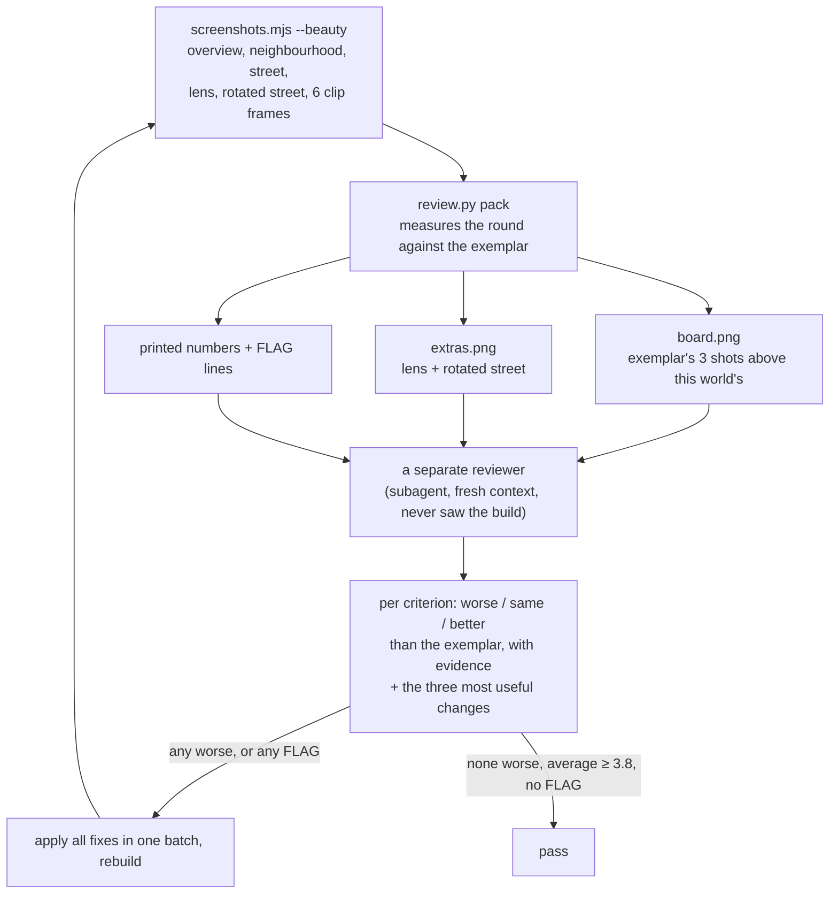

`review.py pack` measures what a script can measure, so the reviewer doesn't have to:

| check | what it catches | how |
|---|---|---|
| value bands | a muddy city that dissolves when you squint | blur 8 px, greyscale, count dark, mid and light pixels |
| contrast | flat light | spread of the blurred brightness |
| overview coverage | a small city floating in empty space | share of the overview that is not sky |
| sky in the opening shot | a horizon in what should be a city view | pixels matching the sky colour |
| flat patches | bare ground or a land use with no surface | the largest connected patch of near-identical colour |
| motion | nothing moving on the streets | pixels that change across the clip frames |

Each is compared with the exemplar, and anything that falls short prints a `FLAG`. The reviewer looks at one board image (two at Gate 7), never the individual screenshots. A FLAG caps its criterion at "worse": the reviewer may explain a measured problem but cannot overrule it.

The ten criteria are value structure, palette harmony, data restraint, silhouette and skyline, facade detail, street and ground, life, light and depth, edge and framing, and fidelity to the art bible. The bar is the exemplar, `reference/exemplars/real-nw-ashford`, which you accepted as good enough. It averages 3.8. A world passes when no criterion is worse than the exemplar's, the average is at least 3.8, and nothing is flagged. Gate 4 allows one round; Gate 7 allows three, and after that the agent reports what is left and you decide.

### The interface and honesty rules

`reference/ui-rules/paperdolls-gates/` holds ten blocking checks, run at Gate 7:

| gate | rule |
|---|---|
| G1 | appearance changes only with something the model tracks |
| G2 | people are paper dolls: one neutral tone, no identity signals |
| G3 | no red-to-green scale anywhere |
| G4 | the model is the source of truth; the page computes no economics |
| G5 | missing data is never drawn as zero |
| G6 | everything invented is labelled |
| G7 | attribution is present (OpenStreetMap, the model, Paperdolls) |
| G8 | same parameters and seed give the same run |
| G9 | keyboard access, visible focus, reduced motion, readable contrast |
| G10 | nothing is fetched from the network when the page is viewed |

After those, a craft pass in `reference/ui-rules/` checks spacing, type, colour and charts.

### Every check, by gate

| when | check | tool |
|---|---|---|
| preflight | environment, versions, project files | `tools/check-env.py` |
| Gate 3 | every guess the ingest made, counted | `scene_report.md` |
| Gate 4 | the map from above and two angles, on one sheet; one beauty round | `screenshots.mjs`, `review.py sheet`, `review.py pack` |
| Gate 5 | the binding's shape; the record and the binding agree | `tools/check-schemas.py`, `tools/check-world.py` |
| Gate 6 | procedure fixtures, the 200-run ensemble, determinism on both sides | `tools/agents` parity scripts |
| Gate 7 | G1–G10, the craft pass, the beauty review, frame rate, one self-contained file, the stage copy unedited, the decisions log complete | `review.py`, `fps.mjs`, `check-single-file.mjs`, `vendor.mjs --check`, `check-world.py` |

## 13. Getting better between runs

Every run writes `skill-gaps.md`: each time a skill was unclear, wrong, missing a file or forced a guess, along with what the agent did about it. After a batch of runs we read them side by side.

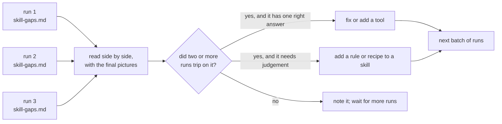

The first batch was three runs of the Jette retrofit model, in November 2026. All three produced a working world with NetLogo parity, and their 81 skill-gap entries produced the current version:

- the stage, after each run rebuilt the camera and pipeline differently;
- the slimmer review, built around one board and a separate reviewer, after self-grading turned out to be unreliable;
- an ingest that keeps the boundary, the railways and finer land cover, after every run worked these out by hand;
- the recipes for terraces, ragged footprints and landmarks;
- rules for questions every run answered for itself: parity scope on a real map, scenarios for a model with no interventions, places kept in a table, marks on the exception.

## 14. Running it yourself

You need Python 3, Node 20 or later, a Chromium-family browser for the screenshots and frame-rate test, and NetLogo 7.0.4 for parity (in `tools/NetLogo` or wherever `NETLOGO_HOME` points). Without NetLogo everything except Gate 6 still works.

```bash
python3 -m venv .venv
.venv/bin/pip install -r requirements.txt
.venv/bin/python tools/check-env.py
```

Then start your agent in the repository and tell it to read `skill.md` and run the pipeline on a model in `netlogomodels/`. It will ask you questions one at a time. The three Jette runs each took between one and a half and two hours.

You can also run it unattended by giving the agent a brief with your answers to the gate questions written out. The DeepSeek and Inkling Jette worlds were made that way. The brief has to say what to do when a question isn't covered (take the skill's recommendation and log it), and has to forbid edits outside the world's folder.

## 15. What it will not do

- Invent data. The model is the source of truth. A building only changes because the model says so.
- Hide a guess. Storeys nobody measured, homes inferred from building size, the colours themselves: all of it is labelled.
- Draw identity. People are paper dolls, in one neutral tone, with no skin, hair or other identity signals. That is where the name comes from.
- Use a red-to-green scale, for anything.
- Need the internet to view. No fonts, CDNs or tracking at view time.
- Pass its own work. 

## 16. Glossary

| term | meaning |
|---|---|
| agent-based model (ABM) | a simulation of many individual agents following rules, such as households deciding whether to insulate |
| art bible | the written brief for how a world looks (`art-bible.md`) |
| binding | how the model's agents and variables attach to the map (`model-binding.json`) |
| breed | NetLogo's name for a kind of agent |
| data lens | the view, toggled with `L`, that shows the roof variable on every roof at full strength |
| determinism | same parameters and seed always give the same run |
| exemplar | the reference city every world is compared with (`reference/exemplars/`) |
| frame | what the model sends after each tick: the tick, the series, the agents' variables |
| gate | a stop in the pipeline where you approve what the agent shows you |
| ingest | turning OpenStreetMap data into `scene.json` |
| ink | the outlines drawn where depth or surface direction changes |
| OKLCH | a colour space (lightness, chroma, hue) where equal steps look equal |
| orthographic | a camera with no perspective: things don't shrink with distance |
| parity | evidence that the TypeScript port behaves like the NetLogo original |
| scene | the place, as data (`scene.json`) |
| skill | a markdown file of instructions the agent loads when it needs it |
| stage | the shared page plumbing in `tools/stage/`: rendering, camera, snapshots, the worker |
| structural reading | a model variable drawn into the buildings, such as a pennant or rising scaffolding |
| tick | one step of the model; Gate 5 decides whether it is a month, a year or just a tick |
| top colour | the one model variable the roofs show |
| world | one finished simulation in `worlds/<name>/` |
| world record | the human-readable file for a world: description, decisions log, attribution |
