# Paperdolls: the manual

Paperdolls turns a NetLogo agent-based model into an interactive 3D city in the browser. Viewed from an isometric angle similar to a city-building game, the environment generates buildings, streets, and parks from OpenStreetMap data or text descriptions, placing simulation agents directly into the map. Running the model animates these agents throughout the city streets rather than in a standard plot window.

Every run outputs a single, fully offline HTML file that requires no installation and can be shared via email, hosted on a web server, or presented directly in meetings.

This manual documents the architecture, file formats, and workflow of the framework.

## Contents

1. The idea in one picture
2. A primer on the web pieces
3. What is in the repository
4. A run, gate by gate
5. The three contracts
6. From NetLogo to TypeScript
7. From OpenStreetMap to a scene
8. Deciding the look
9. The page and the stage
10. The world's own scene code
11. The interface
12. Checking the work
13. Getting better between runs
14. Running it yourself
15. What it will not do
16. Glossary

---

## 1. The idea in one picture

Commercial game engines hardcode their underlying world logic, making them ill-suited for custom economic models. Paperdolls acts as a factory for generating targeted simulation engines. It provides a structured workflow that an AI coding agent executes step by step, requiring human approval at designated checkpoints to produce a self-contained simulation file.

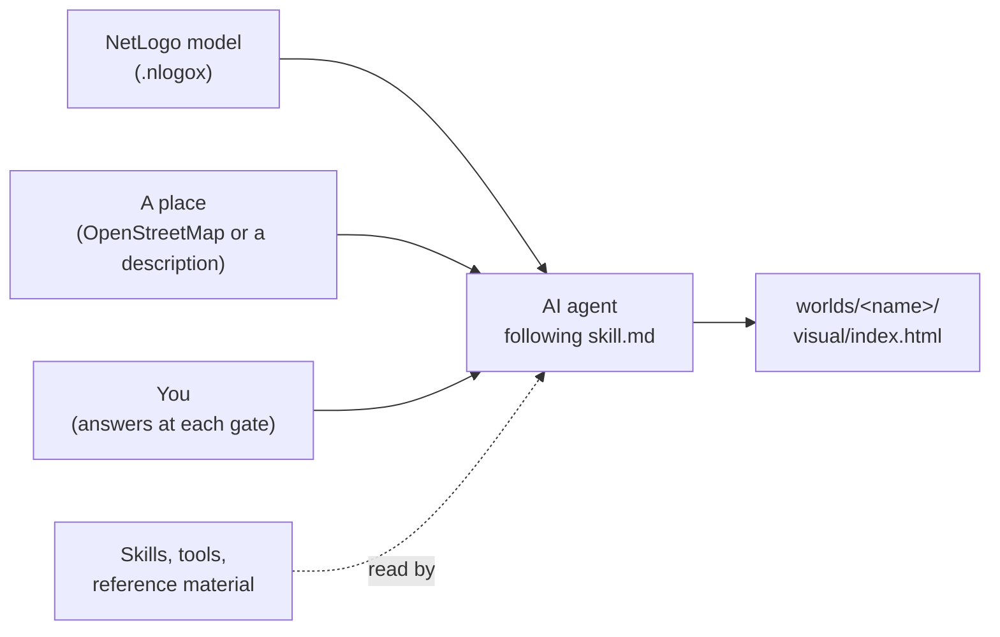

The process works with any file-capable coding agent that can execute terminal commands. Paperdolls has been run using Claude (Sonnet 5.5) via Claude Code, DeepSeek 4.1 Flash via Command Code, and Inkling 2 Small via OpenChamber.

## 2. A primer on the web pieces

A generated world builds into a standard web bundle: HTML for structure, CSS for layout, and JavaScript for runtime logic. Paperdolls inlines all three components, alongside the spatial map data and simulation model, into a single file.

The application source is written in TypeScript and compiled down to JavaScript during the build process. TypeScript enforces static typing (`let height: number = 3.1` instead of `let height = 3.1`), validating types prior to compilation before stripping them for execution.

Key components and their roles in the stack:

| name | what it is | rough equivalent |
|---|---|---|
| Node | runs JavaScript and TypeScript outside a browser; our tools and tests use it | the `python` interpreter |
| npm, `package.json` | installs libraries and records their exact versions | `pip` and `requirements.txt` |
| Vite | the build tool: reads the TypeScript, bundles it and writes `index.html` | a compiler and linker |
| three.js | the 3D library that draws the city with the graphics card (WebGL) | OpenGL with a scene graph on top |
| React and Mantine | the library for the panels, sliders and charts around the city | a GUI toolkit such as Qt |
| Web Worker | a second thread inside the page; the model runs there so the drawing never stalls | a background thread |
| JSON | the text format for data files such as `scene.json` | a Python dict written to disk |

Browser tabs run UI updates and user inputs on a single main thread. Running complex model iterations directly on this thread would introduce frame drops and freeze the canvas. Consequently, Paperdolls offloads model calculations to a dedicated Web Worker thread, which streams state frames back to the main rendering thread.

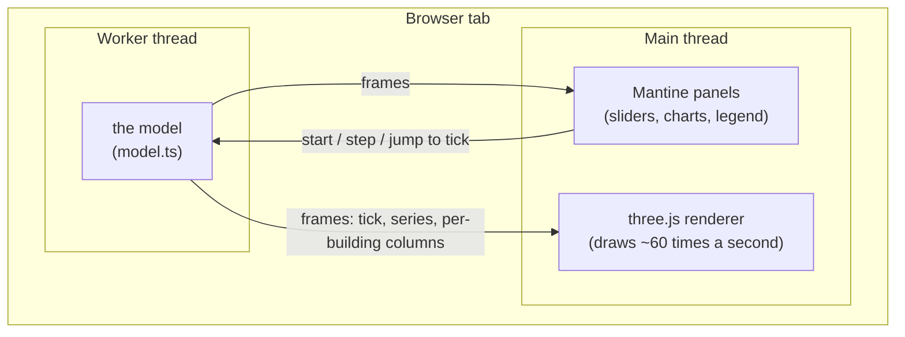

## 3. What is in the repository

```text
skill.md            the entry point the agent loads first: the rules and the routing table
paperdolls.md       this manual
skills/             eight skills, written as markdown
reference/          building types, palettes, the interface rules, the exemplar city, templates
schemas/            the formal shapes of scene.json and model-binding.json
tools/              code: map ingest, the NetLogo runtime and parity harness, the stage, measuring tools, checkers
netlogomodels/      models to run
worlds/             one folder per finished world
```

Repository assets are divided into three operational categories:

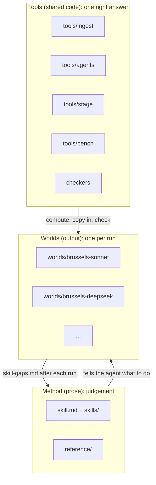

Asset placement rule: components requiring strictly identical output across independent runs belong in shared tooling (`tools/`). Tasks permitting stylistic variations belong in written guidelines (`skills/`).

By codebase size, hand-authored files consist of approximately 31% documentation, 42% source code, 14% tests, and 14% reference datasets. This excludes recorded test fixtures, reference screenshots, and generated output folders.

Responsibility matrix for the eight core skill modules:

| skill | owns |
|---|---|
| `paperdolls-pipeline` | the gates, the questions, the decisions log, the final report |
| `paperdolls-netlogo-to-ts` | reading the model, converting it, proving parity |
| `paperdolls-map-world` | getting the place: OpenStreetMap or construction; the scene contract; checking the map |
| `paperdolls-art-direction` | the art bible |
| `paperdolls-scene-craft` | drawing the world: the house style in numbers and the recipes |
| `paperdolls-beauty-review` | judging the pictures against the exemplar |
| `paperdolls-interface-ui` | the panels around the city |
| `paperdolls-technology` | versions, the offline build, the worker, performance budgets |

The entry router `skill.md` selectively loads only the specific skill required for the active build gate.

## 4. A run, gate by gate

Execution begins by initializing the agent against `skill.md` with a target NetLogo model. Following an automated preflight check, the process advances through eight sequential approval gates. A "yes" approval applies strictly to the current artifact state; subsequent modifications require re-approval.

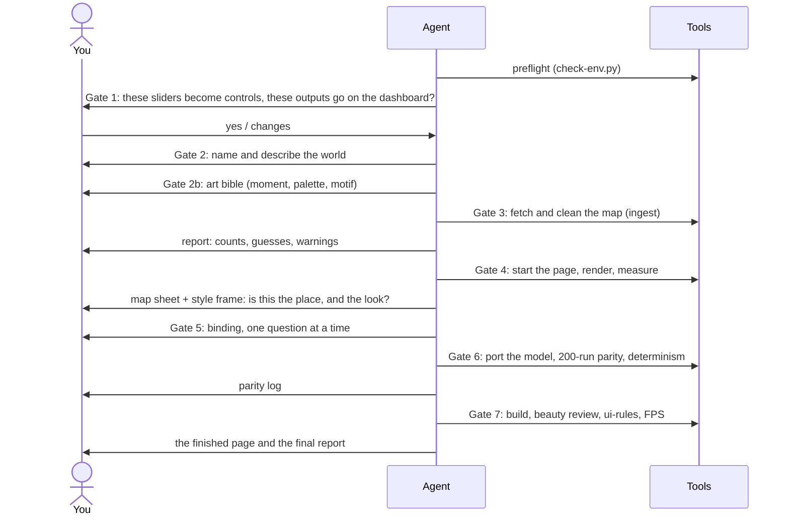

Gate artifacts and validation steps:

| gate | you are asked | the agent writes | checked by |
|---|---|---|---|
| Preflight | nothing, unless something is missing | nothing | `tools/check-env.py` |
| 1. Model brief | which sliders become live controls, which outputs go on the dashboard | the agent and parameter tables in the world record | you |
| 2. World record | the world's name and one paragraph describing it | `worlds/<name>/<name>.md`, with your paragraph kept word for word | you |
| 2b. Art bible | the region, the moment, the palette, the one detail that makes it itself | `art-bible.md` | you |
| 3. Map source | OpenStreetMap (a relation, a box or a file) or a description | `map-data/scene.json` and a report | the ingest report, read out to you |
| 4. Map and style frame | is this the place you meant, and does it look the way the bible says? | the page project and a first picture | one beauty round |
| 5. Binding | which agents live in which buildings, the roof colour, structural readings, the causal graph, scenarios | `sim-code/model-binding.json` | `check-schemas.py`, `check-world.py` |
| 6. Parity | before long runs: whether to start them | `sim-code/model.ts`, `sim-code/parity.md` | the parity harness |
| 7. Sign-off | does it work for you? | `visual/index.html` and `final-report.md` | ui-rules, beauty review, FPS, single-file check |

Decisions append to an immutable log within the world record. Inferred parameters are logged and tagged explicitly as guesses both in documentation and within the rendered interface.

Output directory structure upon completion:

```text
worlds/<name>/
  <name>.md            the world record: description, decisions log, attribution
  art-bible.md         what the world should look like, and why
  map-data/            the map extract, scene.json, the ingest report, the map check images
  sim-code/            model.ts, model-binding.json, parity.md, parity results
  page/                the page's source code
  visual/index.html    the finished page: the thing you share
  visual/review/       the beauty-review rounds
  snapshots/v1/        a frozen, hashed copy of the inputs at sign-off
  skill-gaps.md        everything the agent found unclear or wrong in the skills
  final-report.md      the gate results, the scores, what is guessed, what is left
```

## 5. The three contracts

The client application integrates three primary sources: the compiled model, the scene map, and the aesthetic parameters defined in the art bible. These components interact strictly via structured data files. The application never directly reads raw `.nlogox` files or OpenStreetMap XML.

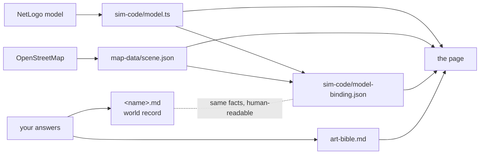

### The scene: `map-data/scene.json`

Scene geometry is defined in meters relative to a central origin point. Structure definitions adhere strictly to `schemas/scene.json`, while building attributes accept open taxonomy values. Truncated scene data example:

```json
{
  "area": {
    "name": "Jette", "source": "osm", "osm_relation": 58258,
    "rotation_deg": 0, "extent_m": [4210, 3480],
    "family": "real", "palette": "nw",
    "boundary": [[-1840.2, 610.5], [-1795.0, 640.1], "…"]
  },
  "structures": [
    { "id": "w123", "kind": "building", "footprint": [[12.1, 4.0], [19.8, 4.0], [19.8, 15.2], [12.1, 15.2]],
      "levels": 3, "levels_assumed": true, "archetype": "terrace",
      "economic_class": "residential", "residential": "probable", "height": 9.3 }
  ],
  "roads":   [{ "id": "w88", "class": "local", "pts": [[0, 0], [140, 2]], "tram": false, "cycle": false }],
  "rails":   [{ "id": "w91", "kind": "rail", "pts": [[-900, 30], [900, 55]] }],
  "landuse": [{ "id": "w77", "kind": "park", "cover": "wood", "footprint": ["…"] }],
  "trees":   [[103.5, 40.2], [110.0, 44.8, "conifer", 1.2]]
}
```

Field semantics:

- `boundary` establishes the spatial boundary polygon (e.g., commune limits) used by ground meshes, boundary plinths, and camera overview framing.
- `levels_assumed: true` indicates that height data was omitted from OpenStreetMap and calculated using fallback heuristics (e.g., 99% of structures in Jette).
- `residential` marks verified residences as `residential`, inferred residences as `probable`, and commercial/industrial structures as `other`. Simulation agents are assigned exclusively to the first two types.
- `kind` assigns structural land use categories (e.g., park, water, rail), whereas `cover` dictates fine-grained surface shader selection (e.g., wood, pitch, cemetery).

### The binding: `sim-code/model-binding.json`

The binding maps internal model variables to physical geometry. Truncated sample configuration from the DeepSeek Jette build:

```json
{
  "family": "real", "region": "nw", "look": "house",
  "dashboard": { "outputs": ["monitor:adopted_units", "monitor:public_cost"] },
  "bindings": [{
    "entity": "buildings", "layer": "structures",
    "top_color": {
      "field": "retrofit_state", "domain": [0, 2], "label": "Retrofit state",
      "ramp": { "name": "plum", "kind": "sequential",
                "stops": [[0.63, 0.035, 300], [0.50, 0.065, 320], [0.38, 0.10, 340]] }
    }
  }],
  "architecture": [
    { "entity": "buildings", "field": "approved", "treatment": "mark", "preset": "flag", "label": "Shared measure passed" }
  ],
  "scenarios": [{ "id": "baseline", "label": "Baseline", "interventions": [] }]
}
```

`top_color` designates the model variable mapped directly to roof surfaces. `architecture` defines structural indicators: physical scene modifications like roof flags or retrofitting facade progress. Color stops are defined in OKLCH space (lightness, chroma, hue).

### The world record: `<name>.md`

The world record acts as a human-readable counterpart to the scene and binding contracts while tracking decision logs and attribution. Built from `reference/templates/world.md`, `tools/check-world.py` validates section ordering, dated gate entries, and schema parity against binding files.

## 6. From NetLogo to TypeScript

### The runtime

Transpiled models run against a core TypeScript emulation layer in `tools/agents/` that mirrors NetLogo primitives: `ask`, `createTurtles`, `oneOf`, `random`, `tick`, and related execution methods. Converted files maintain original procedure names and execution sequences, embedding original NetLogo source blocks directly within code comments.

Implementation example taken from the Wolf-Sheep Predation reference (`tools/agents/examples/wolf-sheep.ts`):

```text
NetLogo:     to move
               rt random 50
               lt random 50
               fd 1
             end
```

```ts
// to move: rt random 50  lt random 50  fd 1
function move(m: Ctx, t: AnyAgent) { t.rt(m.random(50)); t.lt(m.random(50)); t.fd(1); }
```

`m` references simulation context (world bounds, RNG states, live parameters), while `t` targets the individual agent instance. Type signatures (`m: Ctx`, `t: AnyAgent`) are stripped at build time.

The complete model logic wraps inside a single `defineModel({...})` invocation specifying parameter definitions, agent breeds, setup steps, execution loops, UI monitors, and mid-run intervention parameters.

### How the page talks to a model

All transpiled simulation modules implement a uniform runtime interface:

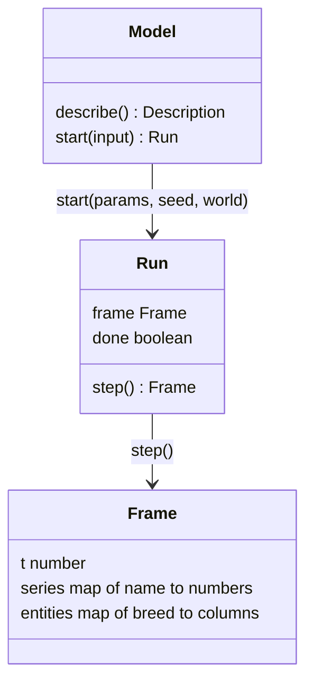

- `describe()` returns parameter schemas, value constraints, registered monitors, and temporal metrics, allowing the UI to render control panels without hardcoded bindings.
- `start()` instantiates a simulation run at tick 0 using provided slider parameters and seed values.
- `step()` advances state execution by one tick and returns frame output. Each frame packs tick indices, plot arrays, and agent attribute tables into typed numerical arrays to enable zero-copy transfers between the worker and main threads.

### Parity: proving the port matches NetLogo

Gate 6 verifies that converted TypeScript code replicates original NetLogo behavior across three test tiers:

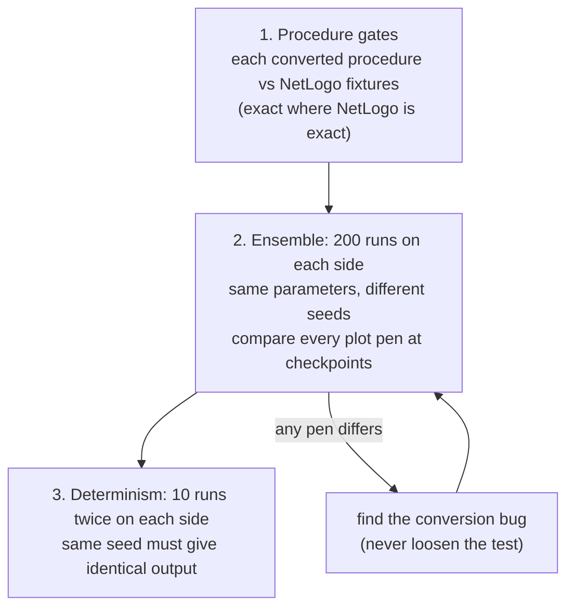

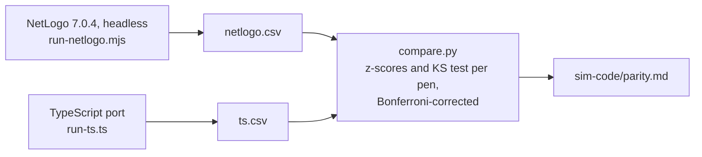

Models driving randomness via internal seed parameters (e.g., the Brussels retrofit model) vary seed values across execution runs. Test outputs write strictly to `sim-code/parity/results/` inside the active world folder.

Parity verification evaluates the model against NetLogo's native synthetic world grid. Web application runs process real-world map geometries, which have no native equivalent in NetLogo. Verification documentation highlights this distinction: arithmetic logic is formally verified, while real-world geographic runs remain illustrative.

Relational model entities lacking explicit spatial coordinates (such as tabular building records) undergo spatial mapping at Gate 5, inheriting concrete surface areas and storey counts directly from real-world scene geometry.

## 7. From OpenStreetMap to a scene

The Python utility `tools/ingest` processes raw OpenStreetMap data into `scene.json`, logging all heuristic assignments to an output report.

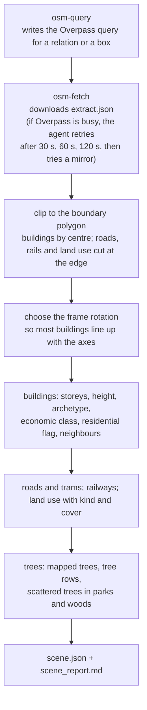

Structural classification evaluates attributes in priority sequence as specified in `reference/building-archetypes.md`:

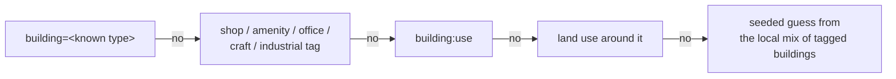

In the Jette dataset, 93% of structures trigger step 5 fallback heuristics due to generic `building=yes` OpenStreetMap tags. The ingestion report flags these fallback rates for human review during Gate 3.

Alternatively, `tools/construct` generates synthetic `scene.json` files for hypothetical maps, maintaining identical compatibility with downstream processing pipelines.

## 8. Deciding the look

### The art bible

Gate 2b establishes visual rules within `art-bible.md` prior to geographic ingestion:

- Environmental context: time of day, season, weather ("3 pm in late May, sunny").
- Palette definitions in explicit color space values.
- Lighting parameters: sun vector, color temperature, illuminance.
- Structural density and skyline constraints.
- Signature architectural motif (e.g., stepped gables, masonry bands).
- Street-level activity density.
- Data visualization overlays.
- Explicit style constraints ("not this").

Render passes at Gate 4 are benchmarked directly against this document.

### Colour in OKLCH

Color palettes use OKLCH values (lightness 0–1, chroma 0–0.32, hue 0–360°). Equal mathematical steps in OKLCH correspond to equal perceptual steps, allowing automated style validation via lightness boundaries:

```text
lightness (OKLCH L)
1.00 ┤
     │  ground, pavements    0.90–0.96   ← lightest surface
0.90 ┤
     │
0.80 ┤  walls                0.60–0.82
     │
0.60 ┤                                  ← roofs at least 0.15 below the wall average
     │  roofs              0.30–0.48
0.40 ┤
     │
0.20 ┤  ink outlines                    ← darkest
0.00 ┤
```

Chroma limits enforce visual hierarchy: background surfaces cap at 0.08 chroma, primary architectural accents cap at 0.16, and data color ramps occupy distinct, non-overlapping color space bands.

### Palette and Data Ramp Allocation

Roof surfaces encode simulation parameters along sequential color ramps. Red-to-green ramps are prohibited to maintain accessibility for color-blind viewers. Color ramps maintain at least a 60° hue separation from building walls, accent trims, sky gradients, and vegetation channels. In brick-dominated environments (wall hues 25–50°, accent hues 205–235°), data ramps allocate exclusively within remaining purple-to-magenta bands:

```text
hue  0        60       120      180      240      300      360
     |--------|--------|--------|--------|--------|--------|
     [walls: brick]
                  [vegetation]
                                    [accent: blue][sky]
                                                    [ free: data ramp ]
```

Shifting data ramps to alternative color bands requires altering secondary accent channels during Gate 2b art direction setup.

### The house style in numbers

Base visual parameters configured across all environments within `skills/paperdolls-scene-craft/SKILL.md`:

| lever | value |
|---|---|
| camera | orthographic, 30° elevation, 45° azimuth |
| exposure | 1.3, AgX tone mapping |
| sunlight | 2.4–2.8 strength, 3,500–5,000 K |
| sky fill | 1.5–1.8 strength, 7,000–9,500 K |
| shading | three-step toon shading |
| ink | 1.5 px at street zoom, 1 px at neighbourhood, none at overview |
| ambient occlusion | blend 0.65, at half resolution |
| data share | data colour covers at most 15% of building pixels in the normal view |

## 9. The page and the stage

### What the page is made of

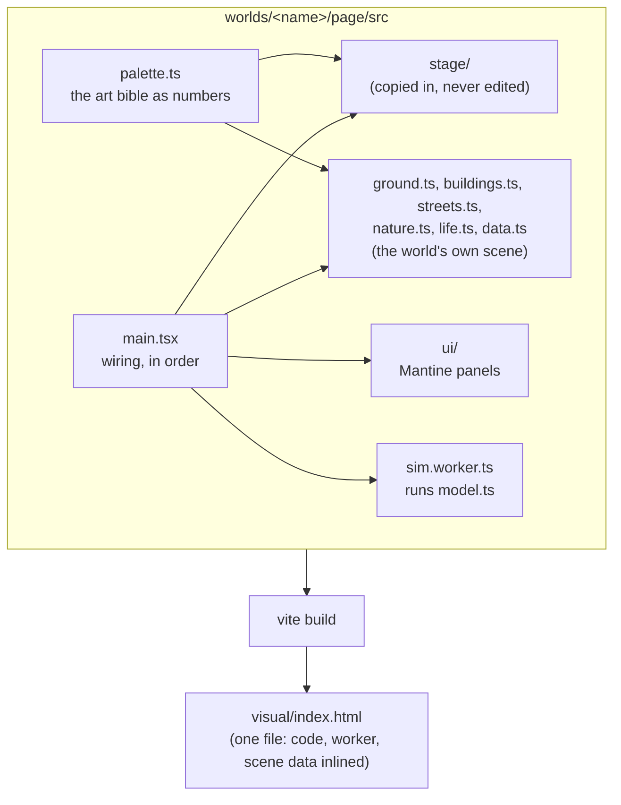

Application files are generated per build run using skill recipes, with the exception of the core rendering stage.

### The stage

Shared renderer components reside in `tools/stage/`. Consisting of ~700 lines of TypeScript targeting three.js r180 across four core modules, this infrastructure provides standardized application mechanics:

| file | contains |
|---|---|
| `pipeline.ts` | the renderer, lights, sky gradient and post-processing; shadows refitted to the view; the boundary plinth |
| `camera.ts` | the camera rig, the three shots, the controls |
| `snapshot.ts` | the URL parameters the capture tools use, and the "ready" signal |
| `sim.ts` | the model worker: `serveModel` inside the worker, `SimClient` on the page |

The rendering stage isolates structural engine code from visual styling. Visual parameters import directly from art bible definitions through structured configuration objects (`StageLook` and `PlinthLook`):

```ts
const stage = createStage(canvas, {
  exposure: 1.3,
  key:  { color: '#ffe2c0', intensity: 2.6, azimuthDeg: 220, elevationDeg: 38 },   // the sun
  fill: { sky: '#cfe0ff', ground: '#c9c2b4', intensity: 1.6 },                     // sky light
  sky:  { top: '#a9c4de', horizon: '#e6e2d8' },
  ink:  '#2b2630',
});
```

Decoupling renderer logic from model geometry allows custom asset generation for each environment without reliance on static asset libraries.

### How a frame is drawn

Render passes execute sequentially using off-screen framebuffers:

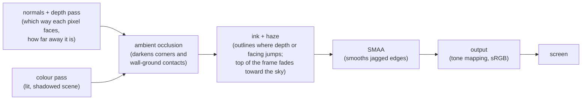

Orthographic projection lacks perspective-based depth falloff. To simulate spatial depth, upper viewport regions blend gradually into horizon sky tones, scaling haze intensity based on active zoom levels (0.10 street, 0.28 neighbourhood, 0.40 overview).

### The camera

```text
                  camera (1,500 m away, looking down)
                     \
                      \  30° above the ground
                       \
                        \
   ____________________\_____________________ ground
                        target

   seen from above: the camera sits at 45° between two street axes,
   and Q / E rotate it in 90° steps.

            N
            |
     W -----+----- E        camera azimuth 45°
            |   ↖
            S     camera
```

Orthographic rendering maintains parallel lines across all distance scales. Viewport width in meters governs scale-dependent rendering values, including outline thickness, haze density, ambient occlusion radius, shadow map bounds, and geometric detail levels.

| shot | view width | what it must show |
|---|---|---|
| overview | the whole boundary, fitted to the screen | districts, skyline, landmark, parks and water, the world's edge |
| neighbourhood (the opening shot) | about 220 m | window rhythm, pavements, tree canopies, moving traffic |
| street | about 62 m | framed windows, doors and shopfronts, people, lamps, benches, the signature motif |

Overview framing fits the perimeter bounds based on current rotation angles. Camera interactions support cursor-centered zooming, panning (drag, WASD, arrows), and stepped rotations (Q/E). Motion easing transitions run across 250–450 ms and disable automatically when system-level reduced motion preferences are detected.

### The snapshot contract

Automated testing tools interface with generated web pages via URL parameters:

| parameter | effect |
|---|---|
| `snapshot=1` | hide the panels, fix all decorative randomness, no easing |
| `shot=overview`, `neighbourhood` or `street` | which shot |
| `lens=1` | turn on the data lens |
| `angle=90` | rotate the camera by that many degrees |
| `view=top` | look straight down (for the map check) |
| `t=120` | show the model at tick 120 |
| `clock=1.5` | set the decorative clock (traffic, people) to 1.5 seconds |

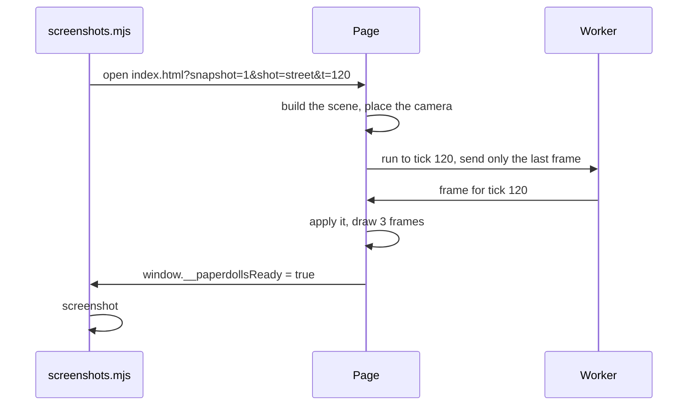

If the parameter `t` is omitted, the application evaluates model frames and selects the tick exhibiting maximum variance across roof data variables (measured via interquartile spread or discrete state distribution).

### Getting the stage into a world

Stage code imports into individual world projects as isolated local files to lock snapshot behavior to the build version.

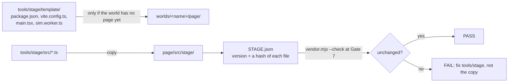

```bash
node tools/stage/vendor.mjs worlds/<name>           # create the page project and copy the stage in
node tools/stage/vendor.mjs worlds/<name> --check   # confirm the copy is unedited
```

Updates to stage logic modify source files in `tools/stage/`, increment `VERSION`, and propagate to target world directories via vendor commands.

## 10. The world's own scene code

Visual elements build from procedural recipes in `skills/paperdolls-scene-craft/recipes/`. Implementations remain isolated within individual world folders without relying on shared runtime styling classes.

### Build order

Scene generation follows a sequential execution pipeline, evaluating intermediate outputs at each stage:

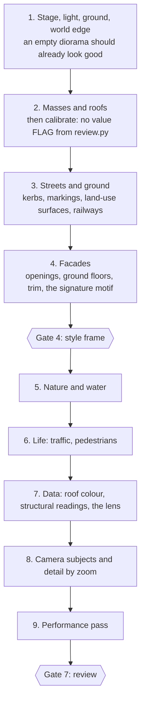

### The recipes

| recipe | covers |
|---|---|
| `render-pipeline.md` | what the stage's passes do and how to tune them |
| `light-and-time.md` | sun and sky, colour temperature, dusk lights |
| `palette-method.md` | building the palette and data ramps in OKLCH |
| `composition.md` | giving a map a centre, a landmark, a height gradient and an edge |
| `buildings.md` | masses, roofs, facades, ground floors, roof furniture, landmarks |
| `streets-and-ground.md` | roads, pavements, markings, plots, land-use surfaces, railways |
| `nature-and-water.md` | trees, hedges, grass, water, shorelines |
| `life.md` | traffic, pedestrians, smoke, birds, model agents |
| `data-in-the-world.md` | the roof colour, structural readings, the lens, missing data, hover |
| `camera.md` | the stage's camera, and choosing what the shots frame |
| `performance.md` | draw-call and triangle budgets, instancing, level of detail |

### Terraced Housing Segmentation

OpenStreetMap frequently represents continuous terraced housing blocks as single contiguous polygons spanning 40 to 120 meters. Rendering these directly produces uniform, repetitive geometry. The building recipe splits contiguous footprints into distinct sub-plots prior to mesh generation:

```text
one OSM footprint, 62 m long
┌──────────────────────────────────────────────────────────────┐
│                                                              │
└──────────────────────────────────────────────────────────────┘
                         street side ↓

split into plots of 5–7.5 m along the street
┌──────┬──────┬───────┬──────┬──────┬───────┬──────┬──────┬───┐
│      │      │       │      │      │       │      │      │   │
└──────┴──────┴───────┴──────┴──────┴───────┴──────┴──────┴───┐
 each plot gets its own wall colour, door and ground floor;
 eave height steps every 1–3 plots; 30–50% get a dormer;
 chimneys sit on the party walls
```

Sub-plots retain parent metadata associations to preserve uniform data overlay rendering and hover states across the original entity footprint.

The recipe also simplifies dense vertex boundaries (resolving high-density 1-meter polygon segments) and formats landmark structures, such as churches, municipal halls, and transit terminals.

### Data Visualization Overlays

In default rendering mode, roof data fields apply selectively to structural accents to preserve overall scene contrast. Toggling the data lens (`L`) renders raw data values across all roof surfaces at full intensity.

```text
normal view                            data lens (L)
  ▲  ridge cap in the ramp colour        ▲  the data at full strength
 ╱ ╲ roof keeps its material,           ╱█╲
╱   ╲ tinted at most 10%               ╱███╲
│ ▯ │                                  │ ▯ │
│ ▯ │                                  │ ▯ │
```

Missing data attributes display as a neutral grey value with a 45° hatch pattern, keeping unrecorded fields visually distinct from zero values.

Structural indicators encode specific variables directly into building geometry—such as roof flags, dynamic scaffolding, or floor-by-floor wall cladding. High-frequency metrics exceeding 30% spatial density invert to highlight minority states or yield rendering priority to the data lens.

## 11. The interface

The interface builds on Mantine (a React component framework) using a standardized structural layout across all environments:

```text
┌─────────────────────────────────────────────────────┬───────────────┐
│                                                     │ controls      │
│                                                     │  sliders      │
│              the city (canvas)                      │  switches     │
│                                                     │  scenarios    │
│                                                     │  seed, reset  │
│                                                     │               │
│                                                     │ attribution   │
├─────────────────────────────────────────────────────┴───────────────┤
│ timeline: play · speed · seek   │ legend │ main chart │ outputs │ impact │
└─────────────────────────────────────────────────────────────────────┘
                                   analyst drawer (slides in): parity, sources,
                                   assumptions, model version, raw data export
```

- The control sidebar manages user inputs, parameters, and preset scenario selections.
- The bottom dock displays live model metrics, simulation control tools, and primary chart outputs.
- The impact view visualizes confirmed causal graphs established during Gate 5 setup.
- The slide-out analyst drawer exposes verification metrics, including parity logs, data provenance, assumptions, model versions, and CSV exports.

Modifying parameter inputs reinitializes execution at tick 0 using the set seed value. For models without mid-run intervention routines, scenarios present as static parameter comparison profiles.

## 12. Checking the work

### The beauty review

Visual evaluation uses automated screenshot verification tools combined with an isolated evaluation agent to ensure consistent grading standards against benchmark exemplars.

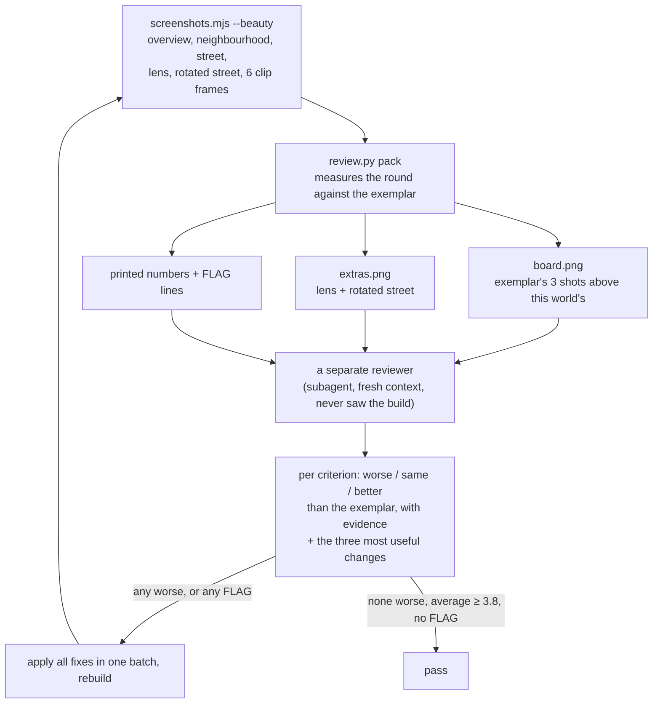

Quantitative metrics captured via `review.py pack`:

| check | what it catches | how |
|---|---|---|
| value bands | a muddy city that dissolves when you squint | blur 8 px, greyscale, count dark, mid and light pixels |
| contrast | flat light | spread of the blurred brightness |
| overview coverage | a small city floating in empty space | share of the overview that is not sky |
| sky in the opening shot | a horizon in what should be a city view | pixels matching the sky colour |
| flat patches | bare ground or a land use with no surface | the largest connected patch of near-identical colour |
| motion | nothing moving on the streets | pixels that change across the clip frames |

Automated script failures output explicit `FLAG` markers, which cap the corresponding evaluation score to "worse". The evaluation agent reviews single consolidated board images (`board.png`, `extras.png`) containing direct visual comparisons against reference benchmarks.

The evaluation criteria cover value structure, palette harmony, data restraint, silhouette/skyline, facade detail, street/ground, life elements, lighting/depth, framing, and art bible fidelity. Targets benchmark against `reference/exemplars/real-nw-ashford` (mean score 3.8). Passing requires no sub-benchmark scores, zero script `FLAG` entries, and an overall mean score ≥ 3.8. Gate 4 permits one evaluation iteration; Gate 7 permits up to three iterations.

### Interface rules

Gate 7 executes ten automated validation rules defined in `reference/ui-rules/paperdolls-gates/`:

| gate | rule |
|---|---|
| G1 | appearance changes only with something the model tracks |
| G2 | people are paper dolls: one neutral tone, no identity signals |
| G3 | no red-to-green scale anywhere |
| G4 | the model is the source of truth; the page computes no economics |
| G5 | missing data is never drawn as zero |
| G6 | everything invented is labelled |
| G7 | attribution is present (OpenStreetMap, the model, Paperdolls) |
| G8 | same parameters and seed give the same run |
| G9 | keyboard access, visible focus, reduced motion, readable contrast |
| G10 | nothing is fetched from the network when the page is viewed |

Subsequent craft passes evaluate UI spacing, typography, palette usage, and chart layouts.

### Verification Matrix by Gate

| when | check | tool |
|---|---|---|
| preflight | environment, versions, project files | `tools/check-env.py` |
| Gate 3 | every guess the ingest made, counted | `scene_report.md` |
| Gate 4 | the map from above and two angles, on one sheet; one beauty round | `screenshots.mjs`, `review.py sheet`, `review.py pack` |
| Gate 5 | the binding's shape; the record and the binding agree | `tools/check-schemas.py`, `tools/check-world.py` |
| Gate 6 | procedure fixtures, the 200-run ensemble, determinism on both sides | `tools/agents` parity scripts |
| Gate 7 | G1–G10, the craft pass, the beauty review, frame rate, one self-contained file, the stage copy unedited, the decisions log complete | `review.py`, `fps.mjs`, `check-single-file.mjs`, `vendor.mjs --check`, `check-world.py` |

## 13. Getting better between runs

Build executions log operational bottlenecks, missing references, and ambiguous instructions to `skill-gaps.md`. Completed logs are analyzed across runs to refine framework tools and guidelines.

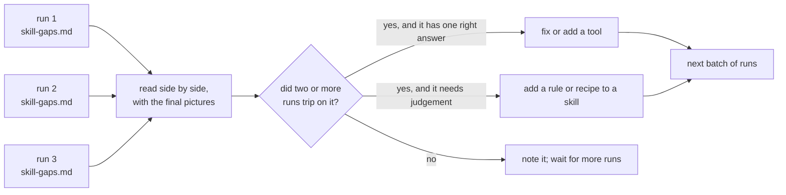

Initial test runs of the Jette retrofit model yielded standard updates that shaped the current platform architecture:

- Standardizing the `tools/stage/` framework to eliminate divergent camera and rendering pipeline implementations across builds.
- Refactoring visual evaluations around single consolidated image boards and isolated reviewer contexts.
- Automating geographic clipping, rail extraction, and land-use parsing directly within `tools/ingest`.
- Writing explicit recipes for terrace splitting, boundary segment reduction, and landmark rendering.
- Defining strict guidelines for edge cases: geographic parity bounds, static model scenario representations, spatial binding of tabular records, and minority data marking.

## 14. Running it yourself

Environment prerequisites include Python 3, Node 20+, a Chromium-based browser (for screenshot rendering and FPS benchmarking), and NetLogo 7.0.4 (located via `NETLOGO_HOME` or placed within `tools/NetLogo`). Omitting NetLogo bypasses Gate 6 parity checking while leaving all other build stages fully functional.

```bash
python3 -m venv .venv
.venv/bin/pip install -r requirements.txt
.venv/bin/python tools/check-env.py
```

To run an interactive build, initialize an agent within the repository, load `skill.md`, and target a NetLogo model file inside `netlogomodels/`. The agent prompts for gate decisions sequentially throughout execution.

For unattended batch generation, provide a configuration brief containing pre-formulated responses to gate decisions. Unattended configurations must define explicit fallback behaviors (e.g., accepting default skill recommendations while logging entries) and restrict file operations exclusively to target world directories.

## 15. What it will not do

- Fabricate data variables. State modifications occur strictly when driven by underlying model outputs.
- Conceal heuristic fallbacks. Assumed heights, inferred building usage, and synthetic palette allocations are logged and labeled.
- Render demographic identity markers. Pedestrian entities use unified, neutral paper doll geometries.
- Use red-to-green color ramps under any configuration.
- Require external network access during client viewing. Assets, fonts, and scripts compile completely offline.
- Allow self-approval of build artifacts. Gates require explicit user sign-off, and visual reviews execute via independent sub-agents.

## 16. Glossary

| term | meaning |
|---|---|
| agent-based model (ABM) | a simulation of many individual agents following rules, such as households deciding whether to insulate |
| art bible | the written brief for how a world looks (`art-bible.md`) |
| binding | how the model's agents and variables attach to the map (`model-binding.json`) |
| breed | NetLogo's name for a kind of agent |
| data lens | the view, toggled with `L`, that shows the roof variable on every roof at full strength |
| determinism | same parameters and seed always give the same run |
| exemplar | the reference city every world is compared with (`reference/exemplars/`) |
| frame | what the model sends after each tick: the tick, the series, the agents' variables |
| gate | a stop in the pipeline where you approve what the agent shows you |
| ingest | turning OpenStreetMap data into `scene.json` |
| ink | the outlines drawn where depth or surface direction changes |
| OKLCH | a colour space (lightness, chroma, hue) where equal steps look equal |
| orthographic | a camera with no perspective: things don't shrink with distance |
| parity | evidence that the TypeScript port behaves like the NetLogo original |
| scene | the place, as data (`scene.json`) |
| skill | a markdown file of instructions the agent loads when it needs it |
| stage | the shared page plumbing in `tools/stage/`: rendering, camera, snapshots, the worker |
| structural reading | a model variable drawn into the buildings, such as a pennant or rising scaffolding |
| tick | one step of the model; Gate 5 decides whether it is a month, a year or just a tick |
| top colour | the one model variable the roofs show |
| world | one finished simulation in `worlds/<name>/` |
| world record | the human-readable file for a world: description, decisions log, attribution |